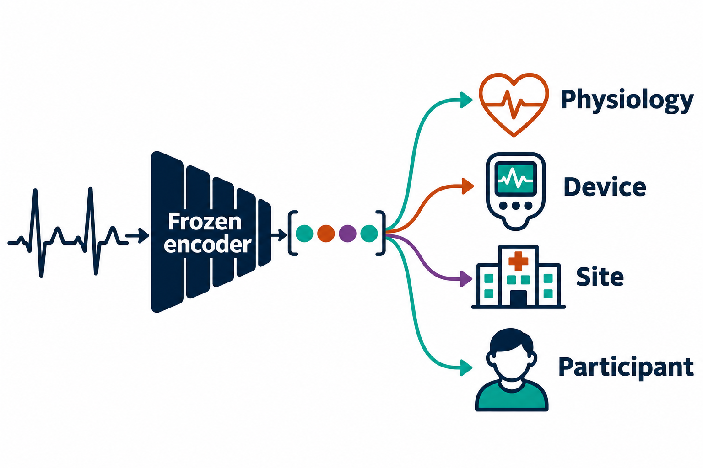
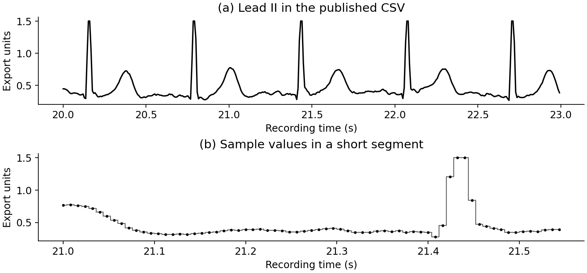
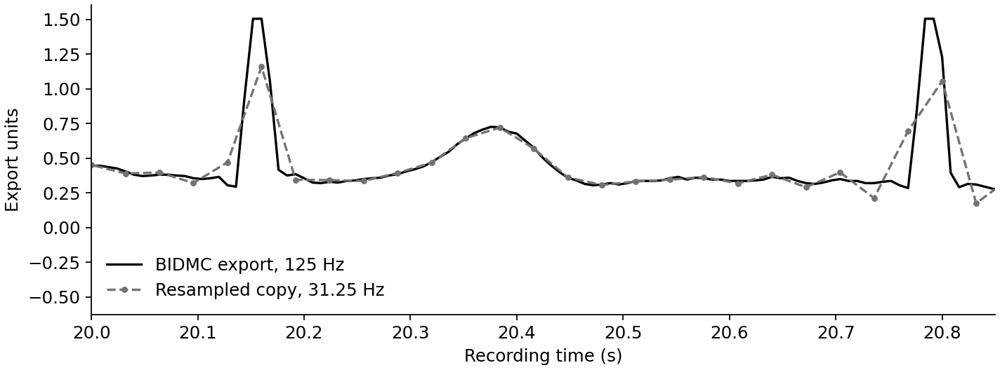

# Do ECG and PPG Foundation Models Learn the Heart or the Device?

Train a probe on top of a frozen ECG encoder and it predicts a rhythm label. Train another probe on the same embeddings and it predicts which monitor produced the tracing. Both can be true. The question is whether the first probe would still work if you changed the monitor tomorrow.

That is a better experiment than asking whether device identity is present at all. Hardware leaves fingerprints that can be useful for signal quality and calibration. The problem starts when a model uses those fingerprints as a substitute for physiology. I'd use three tests to tell the difference: measure what the representation encodes, change acquisition while holding the person fixed, and see whether a physiological prediction survives on a genuinely new device.



## 1. Start with a fingerprint you can actually see

A monitor samples and conditions its input before your model sees anything. Even the file export can leave a fingerprint. If consecutive signal values are reported on a coarse amplitude grid, a model can see that grid. If software removes a narrow band or clips large excursions, it can see the consequence. When every trace from one clinic enters through the same pipeline, recognizing the pipeline can become a way to recognize the clinic.



The close-up comes from one real export. You can find repeated levels directly in the numerical values. That observation motivates an audit. It doesn't establish that a specific vendor caused them or that any pretrained model uses them. To make either claim I'd need recordings from multiple documented systems and an experiment that breaks the association between the export fingerprint and the physiological target. [BIDMC waveform dataset](https://physionet.org/content/bidmc/1.0.0/) · [Pimentel et al., original study](https://doi.org/10.1109/TBME.2016.2613124)

Physiology has its own fingerprints. Rate, QRS morphology, rhythm, pulse shape, and other features can be consistent within a participant. A model that recognizes a person may be using genuine anatomy or a stable measurement setup. An identity probe therefore answers a narrow question. It can establish whether identity is available to a classifier under a stated split. It can't, by itself, establish whether the underlying feature is physiological or a nuisance.

For PPG, the situation is especially tangled. A change in sensor placement or optical design can change the waveform, and so can perfusion and contact. Normalizing scale may remove one acquisition clue and also remove amplitude information that matters for a task. A recent example of explicitly incorporating waveform structure in pretraining is PaPaGei, which uses domain knowledge of PPG morphology. I'd test what that emphasis preserves across acquisition settings, including settings where morphology itself changes. [Pillai et al., *PaPaGei*](https://proceedings.iclr.cc/paper_files/paper/2025/hash/7871f51d332c8661cc729539d7987b21-Abstract-Conference.html)

### Count the steps and test one plausible fingerprint


The step plot puts numbers on part of what you can see in the trace. In this six-second crop, 68 consecutive pairs have identical published values, and 68 have a difference of 0.00392 export units after rounding. Adjacent rounded values can land in neighboring bins, so this is a description of the export and the counting rule. It doesn't estimate a digitizer resolution. You can reproduce it with the public CSV and inspect how the distribution changes if you pick a different interval.

```python
import numpy as np

record = np.genfromtxt("bidmc_01_Signals.csv", delimiter=",", names=True)
lead_ii = record["II"][20 * 125:26 * 125]
steps = np.round(np.abs(np.diff(lead_ii)), 5)
levels, counts = np.unique(steps, return_counts=True)
for i in np.argsort(-counts, kind="stable")[:8]:
    print(f"{levels[i]:.5f}: {counts[i]}")
```

A useful next check is to repeat this with several recordings per device, then compare across devices. Keep windows matched by activity or signal quality where possible. A flat line and a sharp complex naturally have different successive differences even if they were recorded on the same system. A histogram that separates two groups can be separating what the people were doing. To take the next step, fit a small device classifier using only these hand-engineered features and test it on held-out participants. That gives the foundation encoder's device probe an interpretable baseline.

Ask whether the classic fingerprint survives resampling or amplitude normalization. Those operations can erase one cue and introduce another. If every record from a site is resampled through a unique implementation, the learned distinction may simply move to a new fingerprint. Use a common pipeline during the audit and retain the original files or checksums so you can establish which step created any visible difference.


### Look for variation within the same export first


The curves are based on the same feature used in the histogram, but they preserve the distribution within each short interval. Try finding a level where two curves separate and inspect which samples caused it. A short segment with more steep complexes naturally has more large differences. The result is worth remembering before showing a device classifier a large collection of short windows. It can use rate and morphology to predict the expected device if there is enough correlation in the cohort.


Figure 5 intentionally keeps its own units. The BIDMC CSV and PTB-XL export have different acquisition and representation conventions, and the source recordings come from different settings. A difference between these histograms could reflect scale, filtering, rhythm, posture, or selection. The figure is a prompt for a normalization and pairing experiment. Combining the two into one unqualified comparison would make the data look more commensurate than they are. [Wagner et al., PTB-XL dataset](https://physionet.org/content/ptb-xl/1.0.3/)

To practice the comparison, calculate both histograms again after centering and dividing by a scale that was chosen without reference to the labels. Document whether the scale was fit globally on training records, separately by device, or per window. Per-window scaling suppresses amplitude differences but changes the input representation relative to calibrated voltage. Discuss that tradeoff against a specific downstream task. For a small rate-only model, the result may be acceptable. For a morphology task based on amplitude, it deserves a separate check.

A more informative pilot would plot the distributions from many matched windows with separate traces per person. If the separation disappears after matching for rate and quality, a shortcut classifier that was supposedly identifying hardware may have been identifying the cohort or behavior. If it persists, inspect export and preprocessing metadata before attempting an inference about the sensor electronics.

## 2. Draw the shortcut before you train a probe

Picture a dataset from two sites. One has a specialty clinic and one has a screening program. Specialty patients have more positive labels. Each site uses a different device. A model can obtain a decent score without learning the distinction you care about by learning that one acquisition pipeline is more likely to have a positive label.

In the real study I would start with a contingency table. Count people and observations by device, site, outcome, and quality category. Record whether several devices exist at the same site and whether a device appears at more than one site. Complete confounding is easy to miss until you look at these counts. If every device comes from exactly one site, an observational comparison can't cleanly say whether the predictor is identifying the device, the site, or their joint acquisition process.

I’d build the study around contrasts with different strengths of evidence.

| Contrast | What it controls | What it tells you |
| --- | --- | --- |
| Device probe on new participants | Memorization of the evaluation people | Whether device information is accessible in the embeddings |
| Same-person recordings across devices | Stable participant characteristics | How much the representation shifts when acquisition changes |
| Within-device physiology evaluation | Variation among device models in the test condition | How well the target transfers across people using the same hardware |
| Held-out-device physiology evaluation | Direct exposure to the test hardware during downstream fitting | Whether the physiological prediction transfers in that acquisition domain |
| Controlled resampling or amplitude perturbation | All other samples and labels in a record | Sensitivity to one specified signal transformation |

A sound pilot can begin with any one contrast as long as the claim stays inside it. A public dataset with site and device labels gives you somewhere to start probing. Showing the same people with multiple devices gets you closer to a counterfactual. An external evaluation tests whether the overall method travels, even if it can't uniquely assign the cause of every error.

Recent ECG work has investigated how the pretraining data distribution affects performance and generalizability in contrastive foundation models. That's a reason to log what goes into pretraining just as carefully as what goes into a downstream test. If a public checkpoint's training manifest can't establish whether the target site was previously seen, distinguish an unseen **downstream** domain from an unseen **pretraining** domain. [Primary study on ECG pretraining distributions and generalisability](https://pmc.ncbi.nlm.nih.gov/articles/PMC13537565/)

## 3. Freeze the encoder and keep the split honest

The smallest useful probe is a regularized linear model. It tells you whether a signal is easy to read out without training a new deep classifier. Start each probe with features from the same fixed checkpoint and the same input protocol. Fit scaling, regularization, and any feature selection on train and development examples only. That matters because fitting dataset means and variances globally gives the probe information about the held-out cohort.

For the **device** probe, people should be separate between training and test while all device categories being classified appear in training. This asks whether the device's signature generalizes to new people. Holding out a new device requires a different test. A supervised classifier can't predict a device class it was never taught to name, but a physiological classifier can be tested for robustness on it.

For the **identity** probe, design the task as re-identification across separate recordings of known participants. The training and evaluation sets intentionally contain the same identities but different sessions. Compare that with a split that holds out individual windows from the same session. A large drop across sessions tells you the easy score was partly about the recording session. A device-sharing cohort is particularly useful because the model cannot identify one participant simply by reading the only device associated with them.

For the **physiology** probe, separate people and respect time. If the task is classifying a transient ECG event, define the reference for the actual window. If the task is a patient-level attribute, report how multiple windows become one prediction. A per-window confidence score is useful for inspection, but for statistical inference those windows don't represent separate people. Use an analysis that keeps each person's recordings together.

Here's a compact device-probe split. The notebook or data pipeline supplies one embedding per example and aligned device and participant arrays. If a fold's device set is incomplete, investigate the cohort design or use an explicitly documented split.

```python
import numpy as np
from sklearn.linear_model import LogisticRegression
from sklearn.metrics import balanced_accuracy_score
from sklearn.model_selection import StratifiedGroupKFold
from sklearn.pipeline import make_pipeline
from sklearn.preprocessing import StandardScaler

splitter = StratifiedGroupKFold(n_splits=5, shuffle=True, random_state=7)
for train, test in splitter.split(embeddings, device, groups=participant):
    assert not set(participant[train]) & set(participant[test])
    if set(np.unique(device[train])) != set(np.unique(device[test])):
        raise ValueError("Device classes differ across this fold")

    probe = make_pipeline(
        StandardScaler(), LogisticRegression(max_iter=1000)
    )
    probe.fit(embeddings[train], device[train])
    score = balanced_accuracy_score(device[test], probe.predict(embeddings[test]))
    print(f"Device balanced accuracy: {score:.3f}")
```

This probe has a deliberately limited remit. For confidence intervals, save out-of-fold predictions and resample at the participant level, or use an analysis suited to the sampling design. If recordings are uneven across participants, show participant-weighted estimates alongside recording-weighted ones where that distinction matters. If the labels are highly skewed, compare to the appropriate low-information baseline. A single number without that context won't tell a reader how usable the representation is.

## 4. Make a controlled change to the signal

Suppose the device classifier performs well. Try a follow-up that changes a candidate fingerprint while keeping every time window and every label fixed. For example, convert several recordings to a common sampling rate with a documented anti-aliasing filter and see how much device accuracy remains. Then run the same preprocessing in the physiological evaluation. If device predictability drops and held-out physiological results hold steady, that particular cue may be dispensable for the target.

There are at least two ways to misuse this idea. First, suppressing a device probe by changing the data does not guarantee that the representation lost all acquisition information. The linear probe may no longer be able to reach it while a nonlinear downstream model still can. Second, throwing away a signal attribute can make the data appear more invariant because it removed useful physiology as well. Report which physiological targets change, particularly those that rely on amplitude or morphology.

I'd pair each transformation with a physiologically relevant check. If you normalize amplitude, separately inspect tasks where amplitude matters. If you resample, measure landmark timing on annotated ECG and evaluate the shape of sharp complexes. If you alter filtering, compare the transfer functions where known and check for feature shifts on real signals. Choose your transformation family based on the signal and acquisition metadata, rather than trying a stack of unrelated augmentations until the device probe falls.

Paired recordings offer a stronger version of the idea. For simultaneous or closely spaced acquisitions, compute the representation distance between devices for the same person. Compare it against the distance between repeat recordings on the same device and against a between-person comparison matched for rhythm or rate. The same-device repeat is important. Two independent ECG captures of one person can differ even with the same hardware. Without a repeat reference you may attribute normal variation to the device.

If the collection is sequential, evaluate how much state could have changed between captures. For PPG, contact and posture are particularly relevant. For ECG, lead geometry and rhythm stability matter. When you can't hold these fixed, describe your contrast as a change in acquisition conditions. The plot should show paired points and metadata for the conditions that differ. A visually clean cluster diagram is section art until the quantitative comparisons and data provenance support its interpretation.




A resampling intervention is useful because you can run it on exactly the windows that the probe already saw. Figure 6 keeps the original recording and uses the same physical time base while changing the sampling of its digital representation. The dots show the new grid. Sharp complexes are an immediate quality check because the resampled version can lose detail even when its general cadence is unchanged.

For a model experiment, make sure both versions end up in the shape and sample-rate convention that the checkpoint expects. If you need to resample back to the encoder's input rate, record that transformation too. Upsampling an already coarsened signal won't restore the discarded components. The resulting controlled waveform can be used to ask whether the decision depends on those components. It cannot substitute for a real acquisition on a different device.

### What a good probe plot would show

I’d start with the prediction matrix over matched device and site categories. A model that mistakes every device at one site for whichever device dominates that site has learned something different from a model that identifies the same device when it moves across sites. Report per-category counts. If some combinations don't exist, leave those cells blank and state that the effect can't be separated with the cohort in hand.

Then pair the probe score with an intervention effect. Put the device prediction confidence on one axis and the change in physiological prediction on the other for the same transformed examples. Highlight events where the latter changes enough to cross the operating threshold. Those cases make it possible to review the raw signal and determine whether the intervention removed a physiological feature along with the training shortcut.

Finally, compare to labels generated by an explicit low-information rule, such as assigning a risk score using only device and site metadata in the training cohort. If that baseline has surprisingly good in-domain performance and collapses externally, you have evidence about the cohort itself before training a more expensive model. If the foundation encoder shows the same pattern, a controlled intervention is a stronger next step than a larger head. If it transfers well, publish both results so readers can see what kinds of information the representation retained and what behavior it supported.

## 5. Test what the shortcut does to the prediction

Now put the physiological task on three cohorts, where you have them. One is held-out people recorded on known devices. One uses a held-out site with the same device. One has genuinely new hardware. Keep the label definition and evaluation units as similar as possible. Where they differ, list the differences before reporting a performance gap. A held-out site with a different adjudication process can be difficult even if the devices are identical.

For the main result I'd make a device-transfer matrix, with training devices as rows and evaluation devices as columns, plus intervals where sample size permits. Keep the model and training budget comparable. Diagonals show same-device evaluation. Off-diagonals put the same representation to work somewhere else. Add a margin for calibration or coverage if the task will use a threshold. An impressive average may hide asymmetric transfer, where one device generalizes unusually well and another fails on every out-of-device input.

The most decisive comparison is a test where the association between device and disease changes. For example, a new site uses the hardware that was previously concentrated in a specialty setting, but in a broader screening population. If model predictions still follow the acquisition cue after you account for the reference labels, that provides stronger evidence of a shortcut than device classification alone. Be explicit about the remaining confounds. A shift in case mix can change difficulty even when the encoder uses valid signal features.

Look at successes as well as failures. If the device probe is highly accurate and the physiological task generalizes well, the network may retain both types of information. The issue is whether the downstream decisions rely on the wrong one. If a preprocessing intervention reduces device classification and improves target transfer, that's a promising result. Repeat it on another device pair before treating the intervention as a general recipe.

A representation can also be valuable for tasks that explicitly need acquisition context, such as identifying signal quality differences. I'd therefore report whether nuisance information was retained, whether the physiological endpoint used it, and whether removing or isolating it helped external performance. Those are three separate results. A single number labeled invariance can hide all of them.

### Try to falsify the shortcut explanation

Imagine the device probe works, and after amplitude normalization its accuracy falls. Before concluding that the encoder used amplitude scale to decide the physiology label, inspect the actual outputs for those same test recordings. Which predictions changed? Did the score improve specifically where the device and outcome association reversed? Are the changes concentrated near one threshold, or did the ranking of the examples move too? A paired difference in predictions is more informative than two unrelated averages.

I'd use a second transformation that preserves the candidate cue while changing something else. For example, if the hypothesis is that discrete amplitude levels matter, compare a reconstruction on a common continuous scale with a control that re-encodes the same windows using the original grid. Keep every other preprocessing step and the model weights fixed. The intervention still can't establish what a proprietary monitor did upstream, but it can test whether the model's output depends on the specific exported attribute under this manipulation.

Another check is to ask what happens when the disease-device relationship is weakened in development. Match cases and controls inside each device if the cohort supports it. Refit the small downstream model on those matched rows, and compare its cross-device result to one fitted on the original distribution. Matching can alter case mix and discard samples, so log the exclusions and don't compare raw in-domain accuracy across unmatched test sets. The result is most useful when the same external test set is carried through both arms.

If balancing shifts the decisions for one device but not another, examine representative traces. The differences may trace back to a calibration unit, a narrow bandwidth, different positive case definitions, or simple noise. Write each candidate mechanism as a separate hypothesis and show which additional comparison would distinguish it. This is how the plot becomes a useful failure investigation instead of an attractive visualization of a data split.

### Check that the representation still tracks physiology

A shortcut intervention is only as useful as what it preserves. After transforming the inputs, verify that measurements known to be present in the reference still survive. A rate check can use independently annotated intervals. A morphology check can track landmark errors in records with credible annotations. Keep these checks small enough to run on every preprocessing revision, and keep one unchanged baseline to make drift obvious.

If the physiological score falls as the device probe falls, inspect ambiguous cases before declaring the preprocessing a failure. You may have learned that device scaling interacts with the intended signal attribute. The next experiment could supply calibrated scale on one path and normalized waveform shape on a second path, then test each separately. This is particularly important when one device's export values are calibrated and another's are relative. Hold the target and cohort fixed, and probe the decoupled inputs so the outcome has a clear interpretation.

## What I’d want a reader to reproduce

Start with an exported trace and calculate its unique values and successive steps. Make a plot like Figure 2 so the measurement property is visible. Add device and participant metadata to the embeddings, then run the grouped linear probe. Finally, choose one controlled transformation that targets a plausible acquisition cue and rerun both the device and physiological comparisons. Record what changes on the same held-out rows.

For a stronger paper, add paired cross-device recordings, an external cohort, and repeated capture on the same device. Use those data to separate variation due to the person from variation introduced by acquisition. Publish the split manifest and the preprocessing decisions. If the model behaves well on unfamiliar recordings, those design choices will make it possible for somebody else to see why.

The discovery I’d want to show is where the model's evidence changes when the person stays the same and the measurement changes. If you can point to that break in a real trace, then trace it into the model's decisions, you've learned something about the representation that a leaderboard couldn't tell you.

When the final score changes, keep enough information to reproduce the paired differences. Save the exact checkpoint, signal transformation parameters, recording identifiers, and probe coefficients. Repeat the comparison with at least one alternative group split if the cohort is small. A result driven by a single device or clinic should lead to a narrower claim and a follow-up on another independent acquisition.

[PhysioNet platform citation](https://doi.org/10.1038/s44360-026-00096-z)

---

**Previous in the series** · [Can a Model Trained on Hospital ECG Read a Smartwatch ECG?](/blog/hospital-to-smartwatch-ecg)

**Next in the series** · [Can a PPG Foundation Model Tell When It’s Following Your Stride?](/blog/ppg-cadence-foundation-model)
