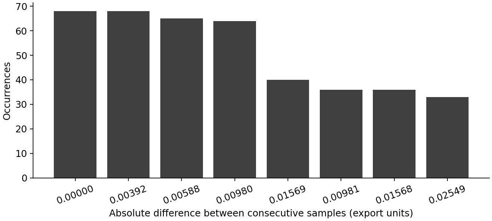
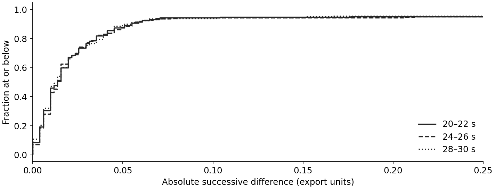
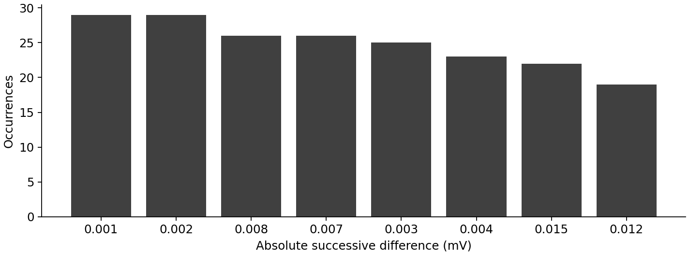

# Do ECG and PPG Foundation Models Learn the Heart or the Device?

I started with a simple question: what can I learn about an ECG export just by looking at neighboring samples? I counted the steps in one real recording, compared several windows from that same file, then changed the sample grid while keeping the source trace fixed. Those checks gave me a concrete way to separate what I could see in the export from what a model might learn from it.


## 1. Count the steps in one ECG export

I used seconds 20 through 26 of BIDMC record 01. The close-up in Figure 2 shows repeated amplitude levels. I calculated the absolute difference between consecutive lead II samples, rounded each difference to five decimal places, and counted how often each value occurred.


```python
import numpy as np

record = np.genfromtxt("bidmc_01_Signals.csv", delimiter=",", names=True)
lead_ii = record["II"][20 * 125:26 * 125]
steps = np.round(np.abs(np.diff(lead_ii)), 5)
levels, counts = np.unique(steps, return_counts=True)
for i in np.argsort(-counts, kind="stable")[:8]:
    print(f"{levels[i]:.5f}: {counts[i]}")
```



I found 68 consecutive pairs with identical published values and another 68 that differed by 0.00392 export units. That gave me a feature I could measure directly from the CSV. I kept the interpretation at the export level because the file doesn’t tell me where those steps were introduced. [BIDMC waveform files](https://physionet.org/content/bidmc/1.0.0/) · [BIDMC data paper](https://doi.org/10.1109/TBME.2016.2613124)

## 2. Compare windows before comparing sources

I repeated the same calculation across three two-second intervals from the BIDMC record. The distributions varied even though all three intervals came from the same acquisition. I then ran the step-count calculation on PTB-XL record `00001_lr`, using lead II and the units declared in that recording’s header.





I kept the two sources on their own scales. The biggest thing I learned from comparing windows was that I could change the step distribution without changing the device at all. A different piece of the same ECG was enough. [PTB-XL waveform files](https://physionet.org/content/ptb-xl/1.0.3/) · [PTB-XL data paper](https://doi.org/10.1038/s41597-020-0495-6)

## 3. Change the grid while holding the recording fixed

For the final check I plotted a BIDMC ECG segment and an antialiased resampled copy on the same physical time axis. The dots show the new sample grid. The two curves retain the same overall rhythm, but the coarser representation has fewer observations around the sharp complexes.


## Where this fits in an encoder audit

I separated physiology, device, site, and participant in Figure 1 because each probe would answer a different question. The waveform checks gave me a way to read that diagram against real data. I saw the feature vary within one recording, and when I changed the sample grid I saw the detail around sharp complexes change too. That helped me pin down which differences I could attribute to my own preprocessing.
