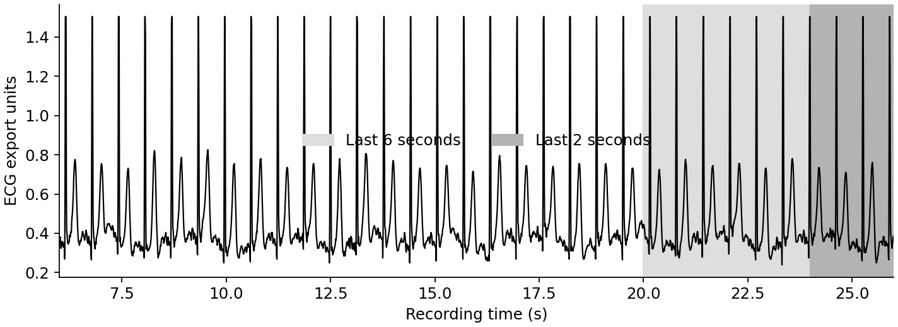
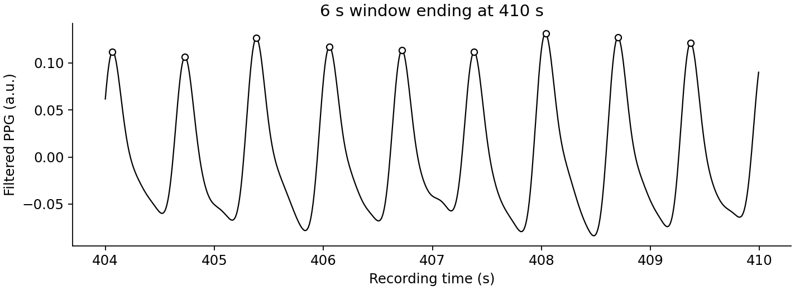

# How Much ECG or PPG Does a Foundation Model Actually Need?

Take a model that does better with ten minutes of ECG than with ten seconds. What did it learn from the extra nine minutes and fifty seconds?

It might have seen the one event that wasn't present in the short clip. It might have found a cleaner stretch of signal. Or it might have integrated useful changes across time. Those explanations sound similar on a leaderboard. They lead to very different designs for a wearable that has to decide when to report.

I’d start with the same person, the same recording, and the same end time. Then I'd change how much history the model can see. The most useful result would break down why longer input helps, and what you can save when it doesn't.


## 1. Look at one recording at several scales

A short ECG window gives a close view of individual beats. A longer window puts those beats in context. A model designed for morphology and a model designed to find a brief event need different things from that context. A rate estimator may need enough cycles to resist one bad interval. An intermittent-event detector needs to see at least part of the event at all.


Read the panels from shortest to longest. The sharp complexes stand out when the horizontal scale is tight. Stretch that view and the individual complexes become less important than how consistently they recur across the window. Both views are derived from the same samples. The appearance changes because the time axis changes. For the model, whether longer windows preserve the same beat detail depends on how they are represented. [BIDMC waveform dataset](https://physionet.org/content/bidmc/1.0.0/) · [Pimentel et al., original study](https://doi.org/10.1109/TBME.2016.2613124)

The SignalMC-MED benchmark reports stronger performance with its full ten-minute input than with shorter segments in the evaluated setting. That motivates the experiment. I'd want to find what the long window adds for each task and checkpoint. A result averaged across tasks can't tell you whether a model detects rare events, accumulates more reliable evidence, or benefits from some property of its input pipeline. [*SignalMC-MED* benchmark preprint](https://arxiv.org/abs/2603.09940)

There's also a practical difference between a waveform that lasts ten minutes and one that supplied ten usable minutes. If half of it was clipped or missing, the elapsed duration describes what the user waited through. The usable duration describes the evidence available to the model. Those belong in different columns of the study.




Figure 3 is a sanity check on what a duration comparison changes. The shorter inputs are literal subsets, and the newest samples belong to all three conditions. If you move the anchor earlier, choose a new set of nested boundaries and recalculate event visibility. A single annotation can pass across the shorter cutoff while staying inside the longest input. That should change the interpretation of the model result even if every signal sample itself is unchanged.

Before encoding, make a table with patient, recording, anchor sample, available duration, usable duration, and any event boundaries. For each duration, add a flag for whether it contains the minimum annotation overlap specified by the evaluation. Plot the distribution of that flag by duration. If visibility rises sharply with duration, a gain in raw detection accuracy may come from exposure alone. To test recognition, inspect the subset in which the event was observable at each compared length.

A second plot I'd make during dataset construction would show eligible examples over time from recording start. Short windows become possible sooner than long ones. If you anchor only where the longest input fits, you hide early behavior. That's fine for a paired comparison that isolates context. A deployment experiment should separately count how soon the first answer is feasible and how much of the recording is covered after gaps.

For the tutorial, retain exact sample boundaries when inspecting the plotted data. Use the cursor to compare the last beat in every condition. If the value changes, your pipeline either moved the anchor or performed scaling inside the individual windows. Both can be intentional in other tasks. For a controlled length comparison, they are separate choices and deserve separate tests.

## 2. Pick the label before picking the window

Suppose your label is *event somewhere in a ten-minute recording*. Cut out five seconds from the end and the event may no longer be present. If you inherit the label unchanged and score every five-second crop as positive, you're testing whether the latest five seconds predict a record-level label. That can be a valid question. It differs from detecting what is happening inside the window.

I’d start with the three versions that are easiest to confuse.

| Task | Reference | What longer input can add |
| --- | --- | --- |
| Detect an event present in the input | Time-local annotation and a required amount of overlap | A higher chance of exposing the event |
| Estimate a patient or recording attribute | Stable reference tied to the person or recording | More repeated evidence or a better chance of finding a clean segment |
| Measure a changing quantity at the decision time | Reference tied to a declared trailing interval | Reduced variability, with possible lag when the quantity changes |

Windowing choices become part of the label definition. For event detection, decide whether a window needs one annotated event, a minimum event duration, or a complete episode. For rate, define whether the label is the rate over the whole input or over a fixed recent interval across all lengths. If the reference interval grows with the input, the measurement itself changes. Keep a fixed reference interval when you want to isolate the effect of history on estimating the same target.

For a stable patient attribute, it may make sense to give every eligible crop the same label. Even then, label stability and measurement evidence differ. Many short windows from one patient turn into heavily correlated observations. Evaluation has to respect the patient as the relevant unit. For event detection, report the analysis on both visible events and all intended opportunities, where appropriate. The first isolates recognition; the second includes the chance that the event appeared in the input.

At the window boundaries, define the time behavior explicitly. A causal system deciding at time T gets samples up to T. A centered offline model gets future context as well. Comparing those two without flagging the difference can make the offline model look like a better wearable. The easiest rule for this tutorial is to end every input at the same decision sample and let the longest condition extend furthest into the past.

## 3. Build nested windows without changing the samples

Pick an anchor time and work backward. Use the original sample grid or a documented common resampling stage shared by every condition. For a simple prototype, store the length in samples and verify that the end sample remains identical across all crops. The following example reads one BIDMC record and prepares the Figure 2 windows. It uses index-based time because the published CSV timestamps are rounded.

```python
import numpy as np

def trailing_windows(signal, end_sample, lengths):
    if not lengths or any(
        n <= 0 or n > end_sample for n in lengths
    ) or end_sample > len(signal):
        raise ValueError("All windows must fit before the decision sample")
    return {n: signal[end_sample - n:end_sample] for n in lengths}

data = np.genfromtxt("bidmc_01_Signals.csv", delimiter=",", names=True)
fs = 125
signal = data["II"]
end = 26 * fs
windows = trailing_windows(signal, end, [2 * fs, 6 * fs, 20 * fs])
for n, values in windows.items():
    assert len(values) == n
    assert values[-1] == signal[end - 1]
```

The end sample in this code is exclusive. That convention keeps annotation comparisons and sample counts simple. If labels use timestamps, choose one conversion policy and test a few edge cases, including an event exactly at a boundary. For modalities with separate clocks, establish their timing basis before calling the same end sample equivalent.

Start with anchors that support every duration. That gives a paired comparison. Otherwise the shortest windows might include recordings that are never eligible for the longest condition, and case mix could explain some of the difference. Then report additional deployment-oriented results for the shorter recordings. A user who removes a device early still creates a real use case even if that record can't enter the paired analysis.

If you choose many anchors from the same acquisition, keep them in the same fold. Near-duplicate windows can overlap substantially, and splitting at the window level would let an almost identical example appear in both training and test. Use a participant split, document whether the sites were also separated, and resample participants when estimating uncertainty for an independent test cohort.

## 4. Separate duration from the amount of usable signal

Lengthen a window and you'll usually collect more cycles. You also increase the chance of finding an unusual event or encountering noise. A long-window method can benefit simply by selecting a clean short span from the available history. That's a different capability from modeling dependencies across the whole record.

I’d add these controls on top of the nested comparison.

| Control | What stays the same | How to interpret a gain |
| --- | --- | --- |
| Short recent window versus long trailing window | Person, decision time, and target | Total value of more past context |
| Always-recent versus one clean short segment picked inside the long window | Short input length to the encoder | Value of being able to select an eligible segment |
| Equal usable seconds with different elapsed spans | Approximate amount of usable data | Whether broader temporal placement adds information |
| Pooled short embeddings versus native long model | Source intervals and decision time, where feasible | Whether modeling between segments helps over short-window aggregation |
| True order versus masked or order-perturbed embeddings | Observed segments and token budget | Whether the chosen model benefits from their order under this intervention |

A clean-segment selector has to operate using information available at runtime. It can't consult the label or look forward unless you explicitly study an offline setting. Compare it with the fixed trailing baseline and report its delay. A model that reports from an older clean segment when the latest input is corrupted may produce a valid description of the past. It needs a freshness rule to claim it describes the current state.

For equal usable duration, preserve the location of gaps. If you glue two distant pieces together into one waveform, you create an artificial adjacency. A model may read a discontinuity as an electrical feature or infer an interval across time it didn't observe. Consider pooling per-segment embeddings with timestamps, or pass an explicit missing-data mask to a model built to handle it. Keep the masking mechanism comparable across conditions so you don't accidentally give one arm a recognizable pattern tied to the target.

The order test also needs care. Moving raw waveform patches can create artifacts no device would produce. Permuting segment embeddings after local encoding makes the intervention cleaner, though it still probes the model under an unusual input. Compare several simple aggregators, including a mean or a quality-weighted pool, before attributing a gain to learned cross-window structure. A good pool is cheap, often straightforward to deploy, and a useful reference for what the long model adds.

## 5. Keep the encoder's real input budget in view

A ten-minute input can mean several different things. You can sample densely and keep every sample. You can increase patch size to keep the token count fixed. You can downsample. Or you can process short segments with an encoder and combine their embeddings. The durations match but the information reaching the model doesn't.

If the goal is to study context, keep sample rate and local patch size fixed in the primary comparison whenever the model allows it. Report how the token count changes. Add a fixed-token comparison as a separate experiment about computational budget. If the longer input requires coarser sampling or pooling, inspect what happened to sharp features. A long-window model can gain from distant evidence while becoming worse at local timing.

Foundation checkpoints may only support a specific input shape or window duration. Padding and masking can change outputs, especially if the implementation was trained with a different pad convention. Verify that the model actually excludes masked inputs where expected. With an encoder pretrained on short windows, test a clean aggregation baseline before extending its context. With a model pretrained on long input, find out whether shorter inputs occupy an unusual position or are padded in a way that makes the comparison unfair. [Pillai et al., *PaPaGei*](https://proceedings.iclr.cc/paper_files/paper/2025/hash/7871f51d332c8661cc729539d7987b21-Abstract-Conference.html) · [*SignalMC-MED*](https://arxiv.org/abs/2603.09940)

There's a deployment cost as well. Measure inference time on the intended hardware if you have it, and distinguish compute from the delay needed to acquire the input. A model that processes a long window quickly may still require the wearer to wait. Once the buffer fills, repeated predictions can reuse history, but recovery after a contact gap remains a separate case. Report how much data it needs before the first estimate, and how it behaves when the buffer contains unusable segments.

## 6. Build the results around the reason longer helps

The first result should be a duration curve for each task, with intervals across people. Put the fixed decision-time conditions in one panel so the reader knows every point describes the same task. Add the number of eligible people and windows. Check the tails. A curve that rises at ten minutes because a few people contribute many difficult windows needs a participant-level interpretation.

Next split by event visibility. Show performance where all compared windows contain the event, where only the long window contains it, and where none contain it but the recording-level target is still positive. Use labels consistent with the task in each of those groups. For a morphology target, split by usable beats instead of event presence if that better represents the problem. That gives a reader a reason to believe the long encoder learned more than patience.


The recorded example illustrates a simpler measurement effect. To reproduce Figure 4, filter the BIDMC PPG offline with a 0.6–4 Hz Butterworth band-pass using forward–backward filtering. Detect peaks with a minimum spacing of 35 samples and prominence 0.08 in the filtered signal's units. For every endpoint from 410 to 439 s, take the detected peaks in each trailing window and calculate 60 divided by their mean spacing in seconds. This is an inspection baseline. The filtering uses samples from both sides of each point, so treat the plot as an offline illustration.

```python
from scipy.signal import butter, find_peaks, sosfiltfilt

sos = butter(2, (0.6, 4), btype="bandpass", fs=fs, output="sos")
pulse = sosfiltfilt(sos, data["PLETH"])
peaks, _ = find_peaks(pulse, distance=35, prominence=0.08)
peak_time = peaks / fs

def peak_rate(end_s, duration_s):
    eligible = peak_time[(peak_time >= end_s - duration_s) & (peak_time < end_s)]
    if len(eligible) < 2:
        return np.nan
    return 60 / np.mean(np.diff(eligible))
```

Try printing the 6-, 20-, and 60-second summaries at the same endpoint. Then move the endpoint by one second. A short window can change considerably when a detected interval enters or leaves it, even when the new sample does not represent a sudden physiological change. A longer window dilutes that effect. If a detected peak is missing, a single long interval can pull the short-window estimate down. Inspect which peaks the simple detector used before reading differences in the curves as changes in the person.

 Summaries over different intervals can move even without a learned model. In a changing signal, a long average and a short recent average can both be correct for the data they cover. This is why I'd lock down the reference interval before evaluating competing models. The figure uses optical peak intervals from the public recording as a demonstration of the estimator, with no clinical annotation claim.

If the long model wins only when it sees an event the short model never received, the next experiment might use a fast detector that can scan the stream and keep strong evidence. If it wins at equal usable data and equal event exposure, timing or structure across segments becomes a candidate explanation. If pooled short embeddings achieve the same result, you may get similar value with a simpler architecture. Publish the comparison either way. A negative result can tell a device team where to spend its memory and battery.


Figure 5 lets you audit what the rate curves are made from. Two windows with the same length can contain different peak counts, and longer duration usually provides more intervals to average. The extrema of a count line depend on the chosen peak detector, the underlying signal, and where the boundaries fall. If a bar or curve looks unexpected, trace it back to the exact peak list before attributing the change to physiology.



In this selected window, the simple detector accepted nine peaks. Plotting those detections exposes what the rate summary hides: you can see the actual local support available to a model that received only this crop. In a research benchmark, use independent beat annotations when the claim is beat detection accuracy. Automatically selected peaks can still be useful for counting candidate evidence and finding cases for review.

### Separate context effects from preprocessing effects

Apply identical preprocessing across the full recording before cropping if the purpose is to compare exactly the retained samples, and document whether that processing will be possible at inference. An offline forward–backward filter can use future data. For a causal comparison, run a stateful filter on the stream up to the decision point, or apply a processing policy that uses only the input available to each model. The right choice depends on which deployment you intend to represent. The tutorial's optical plot is explicitly offline.

Windowwise normalization can also give longer inputs a different reference level. If a short crop is centered on its own mean, then including the crop inside a long context normalization changes the scaled samples fed to the model. That can make a duration result partly about scaling. I'd log the transformation and test a shared scale or the checkpoint's prescribed scaling in a separate control. Make a small signal plot comparing the visible shared region before and after preprocessing to catch this effect.

One more complication is the way a classifier pools its outputs. A max across chunks may boost detection of rare events but can also collect more false alarms as the number of chunks grows. A mean can dilute short events while making a stable patient-level prediction less noisy. Choose a pooling rule matched to the task, give the short-encoder baseline a fair comparison, and inspect how decision thresholds change with duration. Otherwise a longer model can appear better or worse merely because the aggregation rule has a different opportunity to fire.

### What to measure when the long model wins

I’d add a deliberately simple follow-up. Recompute the performance comparison after requiring that the event is visible in both the short and long inputs, with a declared overlap and the same reference label. Compare the long model with an aggregator given the same source intervals. A remaining difference would support a stronger claim about modeling history than a result on a mixture of visible and invisible events.

For a live version, treat the recording as a stream and decide whether to keep observing after every short block. An easy case might need only a short recent window. A difficult case might request more data until the uncertainty falls below a threshold or the permitted wait expires. If you try this, report the distribution of time to decision along with accuracy. An adaptive system can save time on ordinary examples and still have useful context for the hard ones, but only if its confidence tells it when to wait.

Benchmark that policy against simple rules, such as a fixed window and a quality-triggered extension with no learned state. Keep the maximum waiting time the same across methods. Compare results at the same reporting coverage, and report how often each strategy times out or reaches the long-window limit. The study then answers two linked questions. Does more context contain useful evidence, and can the system tell when it needs that evidence?

For the visual comparison I'd place two recordings next to each other. In the first, the longer window includes an event that the short window cannot see. In the second, both windows contain the event, but only one contains enough clean evidence to support a decision. Those are different failure mechanisms. If an adaptive policy handles both, show what made it wait. If it handles only one, that makes the next version much easier to design.

### Make the curve explain the model's decisions

For each point on a duration curve, retain its paired predictions at the individual anchor level. Sort them by the change in loss between short and long, then inspect representative disagreements from prespecified bins. If the same patient contributes many large changes, cluster those observations instead of treating them as independent stories. A few traces chosen by that rule help a reader assess the aggregate instead of simply illustrating the best examples.

I'd also include the useful failure where a long input hurts. Maybe the clean recent beats are diluted by a motion episode, or a classifier continues to give weight to an event that has already ended. Compare the prediction after masking the old segment with the original result while keeping the recent samples fixed. It is a controlled way to ask which history the decision depended on.

## The question I’d put on the paper

What is the shortest input that reaches a useful operating point for this task, and what performance do you lose when you shorten it? Answer that separately for the event detector, the rate estimate, and any morphology-dependent target. Include the device conditions and what qualifies as usable signal. Those constraints turn an abstract context-length result into an engineering decision.

The plots and window code here let a reader reproduce the input side immediately. The full research experiment begins when the same split, labels, sample rate, and evaluation windows are passed through the short and long models. I'd put the best counterexample next to the aggregate curve. The one event that disappears when you shorten the window explains exactly what the extra time bought.

For a reproducible release, preserve the window manifest independently of the model. It should contain the start and end sample, the usable subintervals, and the annotation overlap for each anchor. That lets another group evaluate a new encoder on the same examples. It also makes it straightforward to rerun the experiment after changing a duration or an eligibility rule and to see exactly which rows moved.

[PhysioNet platform citation](https://doi.org/10.1038/s44360-026-00096-z)

---

**Previous in the series** · [Can a PPG Foundation Model Tell When It’s Following Your Stride?](/blog/ppg-cadence-foundation-model)
