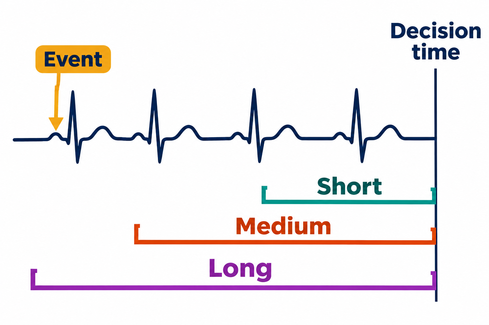
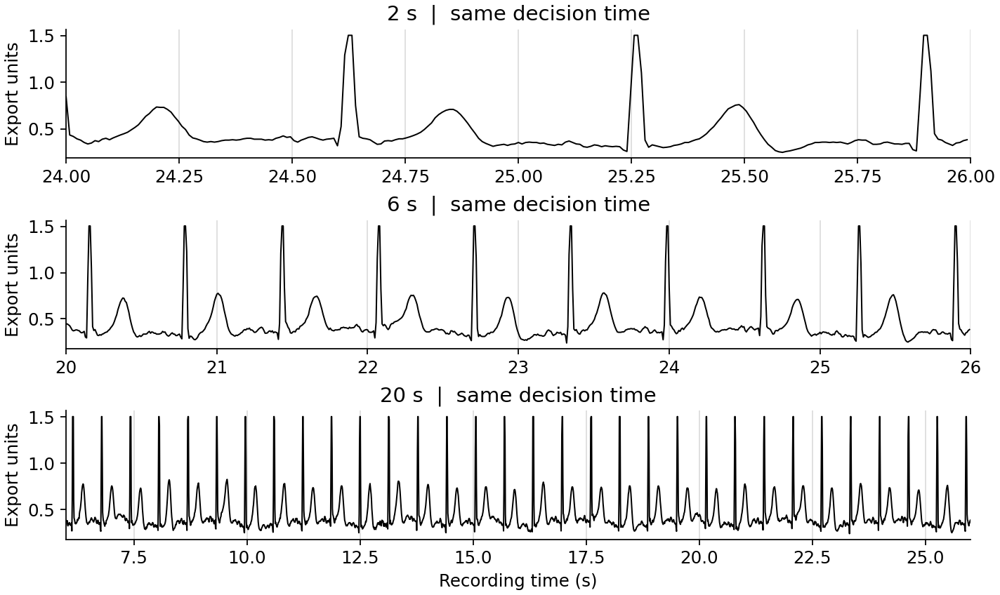
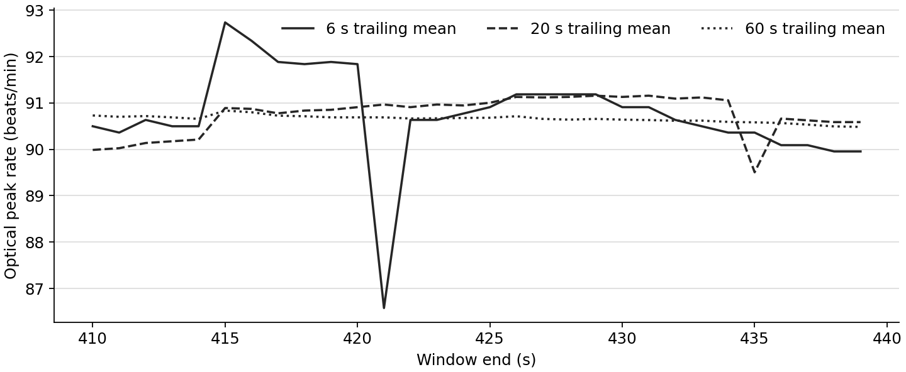
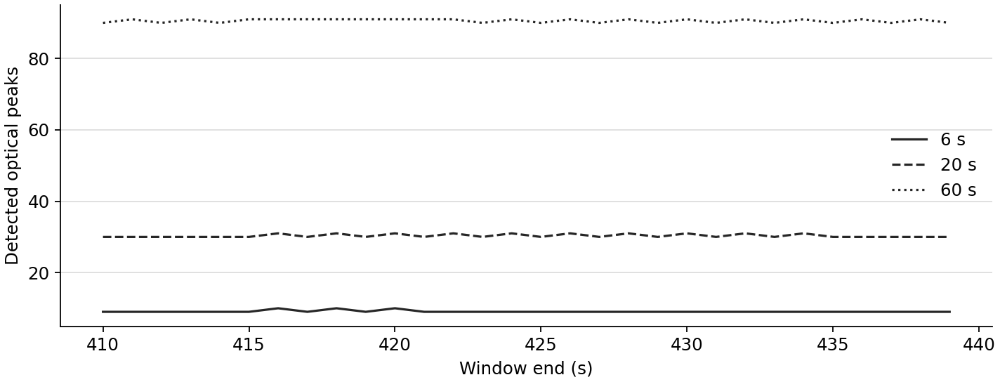

# How Much ECG or PPG Does a Foundation Model Actually Need?

I compared short and long windows from the same ECG without moving the decision time. That let me see exactly which samples the longer input added. I then repeated the trailing-window comparison with a simple optical pulse-rate estimator to see how the duration changed the summary before a model entered the picture.

## 1. Cut nested windows from one ECG

I used lead II from BIDMC record 01 at 125 Hz. The two-, six-, and 20-second windows all end at 26 seconds. Each shorter crop is an exact suffix of the longer one. Figure 1 shows how an earlier event could fall outside a short input. Figures 2 and 3 show the actual crops and their overlap.






I used the sample index to construct time because the CSV timestamps are rounded. The code checks the length of every crop and verifies that all three share the same last sample. [BIDMC waveform files](https://physionet.org/content/bidmc/1.0.0/) · [BIDMC data paper](https://doi.org/10.1109/TBME.2016.2613124)

```python
import numpy as np

def trailing_windows(signal, end_sample, lengths):
    if not lengths or any(
        n <= 0 or n > end_sample for n in lengths
    ) or end_sample > len(signal):
        raise ValueError("All windows must fit before the decision sample")
    return {n: signal[end_sample - n:end_sample] for n in lengths}

data = np.genfromtxt("bidmc_01_Signals.csv", delimiter=",", names=True)
fs = 125
signal = data["II"]
end = 26 * fs
windows = trailing_windows(signal, end, [2 * fs, 6 * fs, 20 * fs])
for n, values in windows.items():
    assert len(values) == n
    assert values[-1] == signal[end - 1]
```

## 2. Measure pulse rate at different durations

I filtered the optical trace offline with a 0.6–4 Hz Butterworth band-pass, then detected peaks with a minimum spacing of 35 samples and prominence of 0.08. At each endpoint from 410 to 439 seconds, I counted the peaks in the preceding six, 20, and 60 seconds. For windows with at least two peaks, I divided 60 by the mean interval between them.

```python
from scipy.signal import butter, find_peaks, sosfiltfilt

sos = butter(2, (0.6, 4), btype="bandpass", fs=fs, output="sos")
pulse = sosfiltfilt(sos, data["PLETH"])
peaks, _ = find_peaks(pulse, distance=35, prominence=0.08)
peak_time = peaks / fs

def peak_rate(end_s, duration_s):
    eligible = peak_time[(peak_time >= end_s - duration_s) & (peak_time < end_s)]
    if len(eligible) < 2:
        return np.nan
    return 60 / np.mean(np.diff(eligible))
```






At the 410-second endpoint, I counted 9, 30, and 90 peaks in the six-, 20-, and 60-second windows. I got 90.5, 90.0, and 90.7 beats per minute, respectively. Figure 4 traces the three estimates across endpoints, Figure 5 shows the underlying peak counts, and Figure 6 marks the nine detections in the six-second example. I filtered the entire trace before cropping, so those plots use an offline detector with access to samples on either side of an endpoint.

## What I learned from keeping the endpoint fixed

Keeping the ECG endpoint fixed helped me see exactly what I was giving up with a shorter input. When I applied the same setup to PPG, I saw the rates move even though I kept the detector and the endpoint fixed. I had changed the period the estimator was averaging. That was the part I could see before bringing a foundation model into the comparison.
