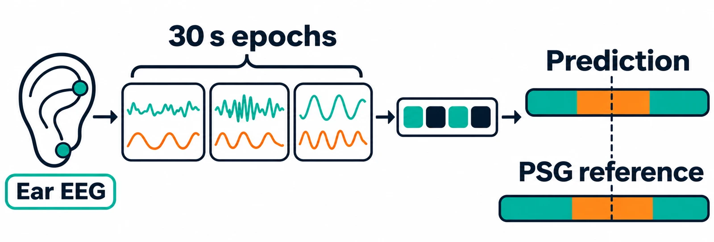
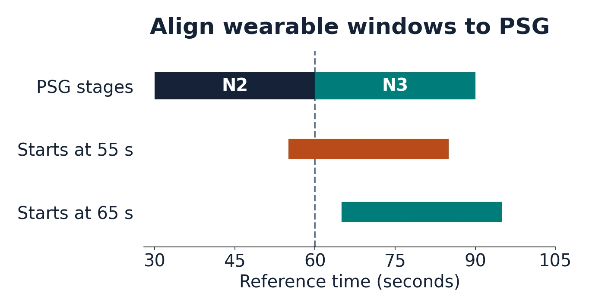
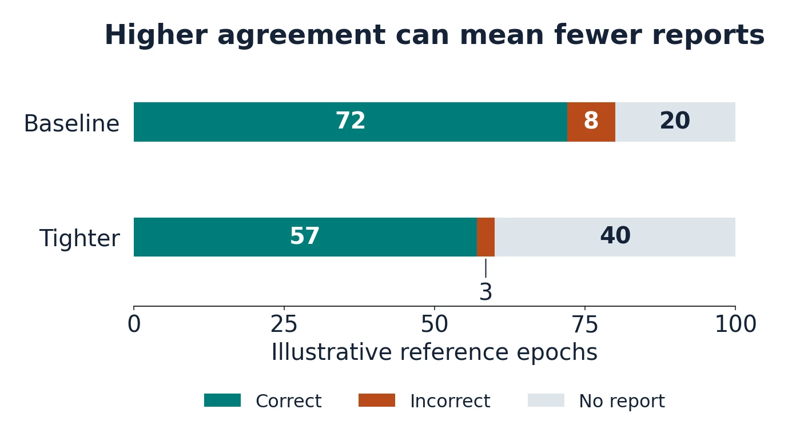

# Ear-EEG Sleep Staging at Home

Ear-EEG can estimate sleep stages at home. Electrode placement, timing, and missing data determine how well those estimates agree with polysomnography.

The difficult part of building a sleep tracker is the hour when someone rolls onto their side, one electrode stops making good contact, and the software still draws a perfectly continuous hypnogram. A night can look complete in the app even when the model had weak evidence. To make sense of an ear-EEG sleep study, I’d start by asking how much of the night was actually observed and how those observations were matched to the reference.

## What ear-EEG measures

Ear-EEG records voltage differences between electrodes placed in or around the ear. An EEG channel is a difference between two recording sites. Changing the spacing, orientation, or reference changes which components of the signal are visible above noise. A pair within one ear, a pair spanning the ear and nearby mastoid, and a pair spanning both ears give the model different inputs even if all three products say “ear-EEG” on the box.

That distinction showed up in a concurrent polysomnography and actigraphy comparison by Tabar and colleagues. For five-stage classification, the reported Cohen’s kappa values were 0.36 for a single ear, 0.63 with a same-side mastoid electrode, and 0.72 with a cross-ear configuration. Kappa measures agreement after accounting for the agreement expected from the two label distributions. These results describe those specific configurations, recordings, and scoring methods. The engineering takeaway is to benchmark the montage you can actually ship. [Tabar et al., Ear-EEG for sleep assessment](https://pure.au.dk/portal/en/publications/ear-eeg-for-sleep-assessment-a-comparison-with-actigraphy-and-psg/).

## Put the wearable and PSG on the same clock

Polysomnography (PSG) uses several signals to characterize sleep. A reference scoring setup can use scalp EEG alongside eye movement and chin muscle signals, giving the scorer cues the ear device may only capture indirectly. In the five-class setup, the labels are wake, N1, N2, N3, and REM. One practical question is whether the wearable and the reference assign those labels to the same 30-second interval.

Keep the original timestamps, record the reference epoch origin, and inspect alignment at the beginning and end of the night. A fixed offset shifts every epoch equally. Clock drift grows with elapsed time. Packet gaps create discontinuities that can look like a clock offset if you reconstruct time by counting samples across the gap. Store the offset or clock mapping used to pair the streams alongside the comparison results.

A timing error usually matters most near a stage change. In the schematic below, the true transition occurs at 60 seconds. A nominal 30-second model window starting at 65 seconds would be entirely within the new stage, while a window starting at 55 seconds would contain five seconds of the old stage. Both could be assigned to the same nominal comparison epoch if timing provenance is missing. Test timing with a sync event or a documented shared timestamp. Searching for the offset that maximizes agreement on the test labels would use the answers to repair the measurement.

Association between the sensors can help troubleshoot synchronization. It can also be misleading when two channels measure different physical events. The [wearable ECG and PPG filtering article](/blog/wearable-signal-filtering) covers a related situation where processing delay and clock alignment both change the apparent timing of a landmark.

## Train on the signal you expect to have overnight

Start with a model you can inspect. For each epoch, record which channels are usable and compute a small set of time-domain and spectral features for those channels. A simple classifier on log band powers and signal statistics gives you a baseline before you add a sequence model. Keep the sampling rate, filter settings, normalization, and preprocessing version with the model.

A sequence model can use neighboring epochs when the current window is ambiguous. Specify its access to context before evaluating it. An overnight report can use both earlier and later observations. A live estimate can use past context and any explicit delay you allow. If the evaluation uses future epochs or a normalization constant computed from the whole night, report it as an offline result.

Look at the failure clips alongside the confusion matrix. For example, prolonged movement or contact loss can leave low-frequency swings in an ear channel. Those swings deserve a quality flag before a model assigns them to N3 because of their spectral content. Conversely, quality rules that reject every large slow deflection could discard useful sleep EEG. Audit per-stage coverage against the PSG labels to see which parts of the night your rules make harder to score. Early ear-EEG work compared characteristic events such as sleep spindles and K-complexes across scalp and ear channels. Those comparisons are useful when deciding which features to expect in a particular montage. [Mikkelsen et al., Automatic sleep staging using ear-EEG](https://pmc.ncbi.nlm.nih.gov/articles/PMC5606130/).

## Report coverage alongside stage agreement

Suppose a wearable attempts 100 PSG-labeled epochs. It accepts 80 and matches the reference on 72 of those. That’s 90% agreement among accepted epochs, 80% coverage, and a correct reported stage for 72% of all reference epochs. Now tighten the quality rule. If the model accepts 60 epochs and matches on 57, accepted agreement rises to 95% while the fraction of the full reference night with a correct output falls to 57%. These are illustrative counts.

The last number combines reporting and correctness. It gives a different view from counting every missing stage as a wrong classification, because the figure preserves the separate counts. Report acquisition coverage for all scheduled time, then model coverage and agreement within intervals where a reference is available. A night without a usable PSG reference can still tell you about device uptime and contact failures. Leave it out of the stage agreement calculation and account for it explicitly in the study flow.

For a continuous overnight report, preserve gaps in the hypnogram. If you also show an estimated total time in REM, say how gaps were handled. An estimator can count only observed REM or impute an estimate using context, with uncertainty. A gap of 25 minutes late in the night can make an apparently precise REM total depend heavily on which choice the product made.

## Validate across people and nights

Split participants before training, including every night from a given participant in the same partition. Otherwise, a validation night may share electrode geometry, recording hardware, and stable characteristics with that participant’s training nights. When the goal is personalization after a calibration night, evaluate that separately and define exactly what data is available to personalize it.

A validation report should include stage-specific precision and recall, a confusion matrix, agreement per participant, and coverage. Record the distribution of sleep stages in the reference because aggregate accuracy can conceal weak performance on an infrequent class. To estimate uncertainty, resample participants rather than treating thousands of adjacent epochs as independent. Also show epoch-level agreement and the error on nightly summaries separately. A model can produce a reasonable total sleep duration while misplacing individual awakenings.

The public ear-EEG sleep monitoring datasets document two studies designed around home recording. They give a starting point for external evaluation. Check which nights have concurrent reference data, the electrode configuration, and how scoring was performed before combining results across studies. The generic at-home ear-EEG study also gives a direct view of the practical question a deployment must answer: how well recordings work with a device designed for home application. [Mikkelsen et al., Ear-EEG sleep monitoring datasets](https://doi.org/10.1038/s41597-025-04579-8). [Tabar et al., At-home sleep monitoring using generic ear-EEG](https://pubmed.ncbi.nlm.nih.gov/36816118/).

The most informative output is a hypnogram you can trace back to the measurement. Pick an apparent transition, open the corresponding ear waveform and quality flags, then check the reference epoch and the model’s available context. You’ll learn whether the next improvement needs a better electrode, a better clock, or a better classifier.
