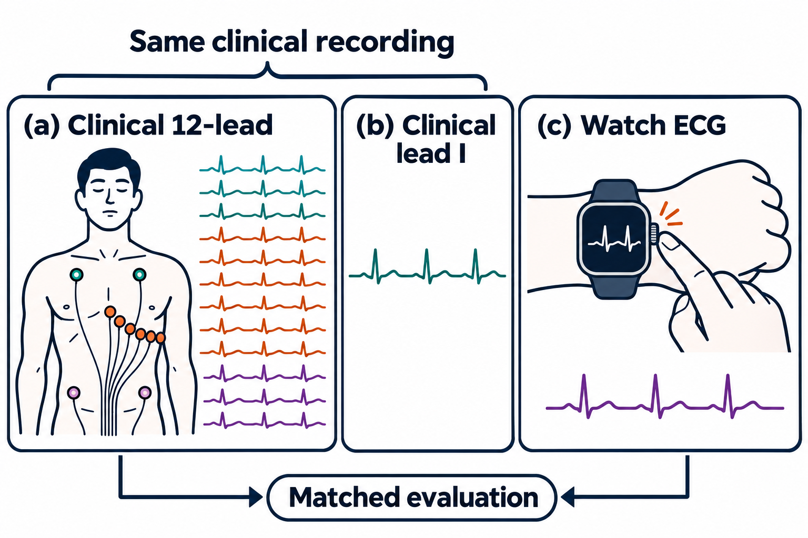
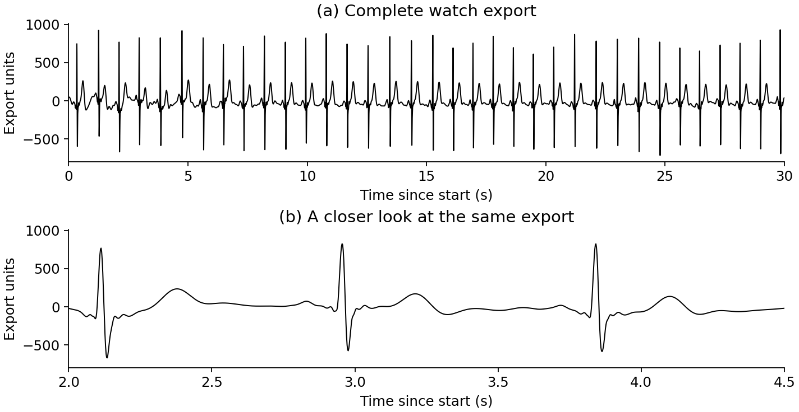
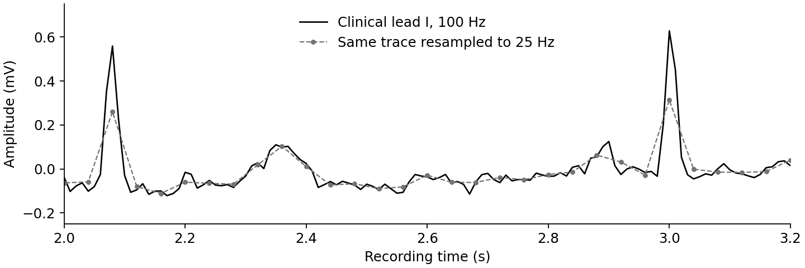

# Can a Model Trained on Hospital ECG Read a Smartwatch ECG?

I wanted to separate two changes that happen when a hospital ECG model receives a smartwatch recording: it loses most of the clinical leads, and it sees a signal collected on a different device. I examined those changes separately. First I dropped channels from a PTB-XL trace. Then I compared a real same-visit clinical and Apple Watch pair. Finally I resampled the clinical trace to isolate the effect of a coarser sample grid.

## 1. Remove leads from the clinical recording

I loaded the 100 Hz PTB-XL record `00001_lr`, displayed several leads, and retained lead I as the single-channel input. The source recording and time interval stayed fixed. When I overlaid lead I and V2, I could see how much the amplitude and shape changed for the same beat. Keeping the acquisition fixed helped me isolate what I lost when I kept only lead I.




The extraction below identifies lead I by the recorded channel name and prints its sample rate and units. [PTB-XL waveform files](https://physionet.org/content/ptb-xl/1.0.3/) · [PTB-XL data paper](https://doi.org/10.1038/s41597-020-0495-6)

```python
import numpy as np
import wfdb

record = wfdb.rdrecord(
    "00001_lr", pn_dir="ptb-xl/1.0.3/records100/00000"
)
lead_index = record.sig_name.index("I")
lead_i = record.p_signal[:, lead_index]
time_s = np.arange(lead_i.size) / record.fs

assert len(record.sig_name) == 12
assert lead_i.size == record.sig_len
print(record.fs, record.units[lead_index], time_s[-1])
```

## 2. Compare a same-visit clinical and watch recording

I plotted SJLIFE pair 132 on separate axes. The clinical panel uses the first stored channel and its sample index. The watch panel uses its documented 512 Hz time base. I kept the original scales so the comparison did not imply equal amplitudes across the devices.


The recordings were paired by visit. The dataset protocol collected the clinical ECG with the participant supine and the watch ECG with the participant seated. The data paper reports a mean interval of 42 minutes between captures. That makes this a comparison within one person and visit, with acquisition conditions and timing still differing between the panels. [SJLIFE paired recordings](https://github.com/akbilgic/SJLIFE-Paired-Clinical-and-Apple-Watch-ECG-Repository) · [SJLIFE data paper](https://doi.org/10.1016/j.dib.2026.112452)

I also plotted the watch export in full and zoomed in on a shorter interval. The full view shows the recording’s overall baseline and recurring complexes. The short view makes the shape of individual beats easier to inspect.



## 3. Isolate the sampling change

I took the original 100 Hz PTB-XL lead I segment and used antialiased resampling to produce a 25 Hz copy. The lower-rate grid has fewer samples near the sharp part of each complex. Since both came from the same trace, this comparison isolates the resampling operation.



Running these comparisons separately helped me trace three changes I would otherwise have seen all at once. I saw what disappeared when I removed the other leads, what differed in a real same-visit watch recording, and what I could reproduce by changing the sample grid alone. That gave me a clearer picture of the inputs before making any claim about model accuracy.
