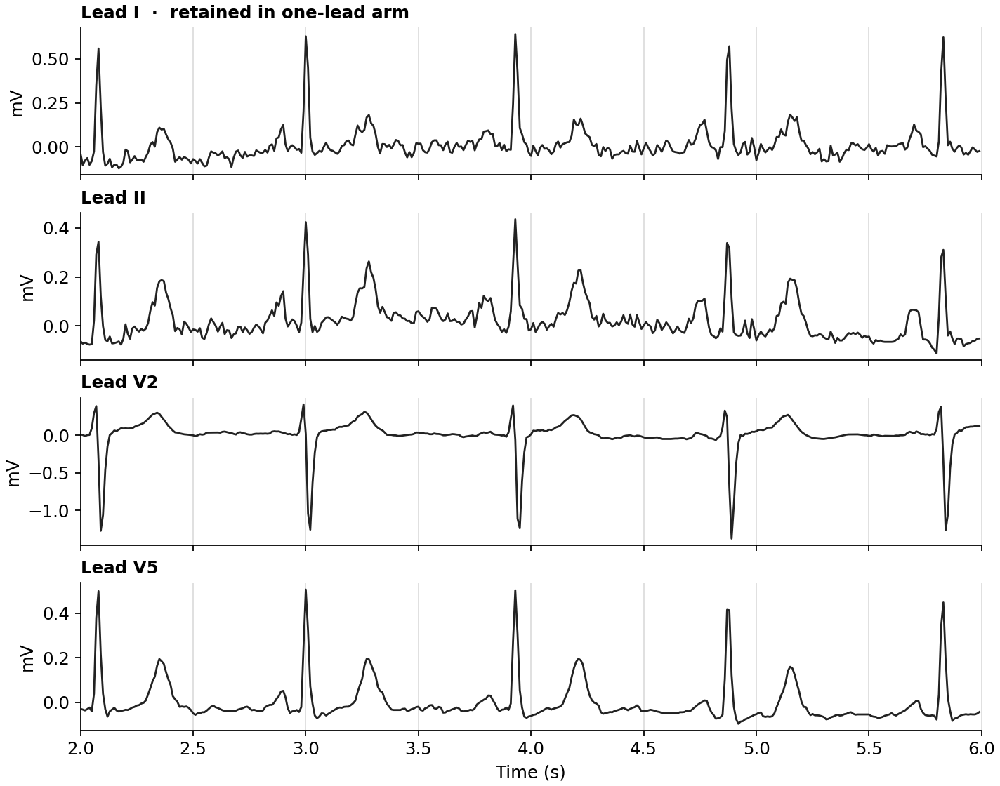
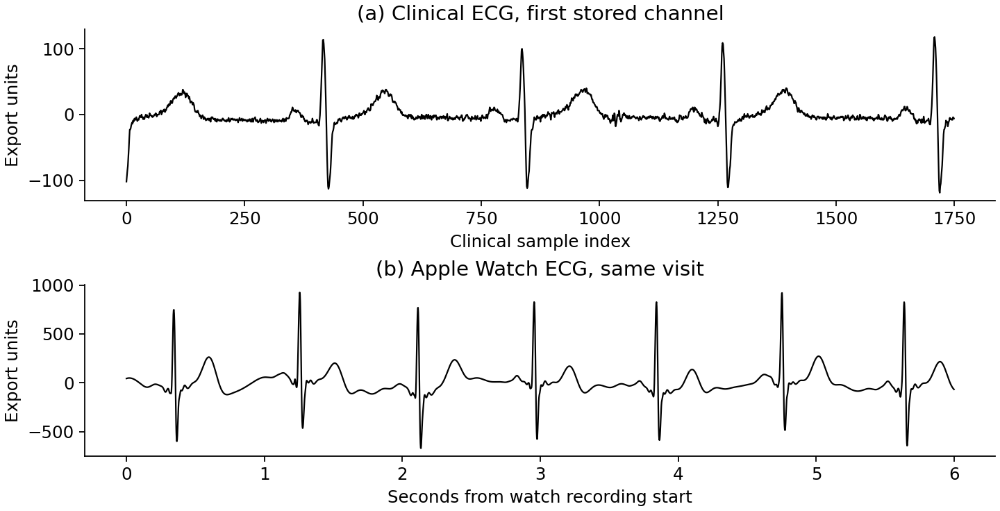
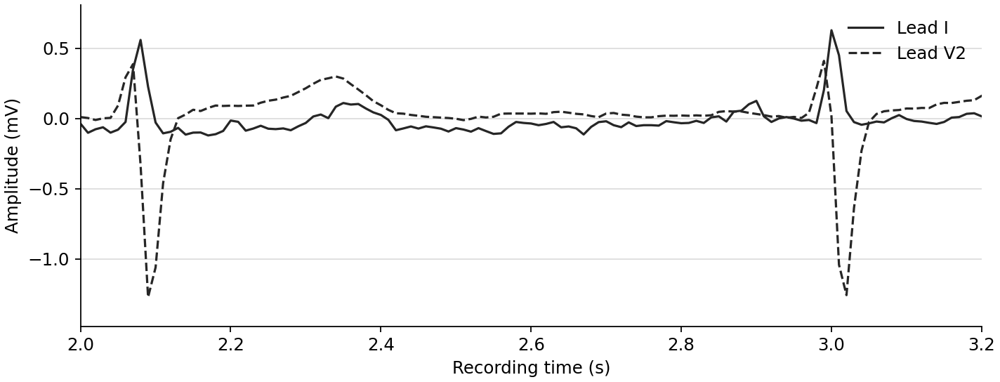

# Can a Model Trained on Hospital ECG Read a Smartwatch ECG?

Take an ECG model with a strong result on a hospital test set and give it a tracing recorded on the wrist. If the score drops, the usual explanation is that the watch has only one lead. That's plausible. It also leaves a harder question. How much did the model lose because it saw the heart from fewer angles, and how much did it lose because the waveform came from different hardware in a different setting?

I'd build the experiment around that distinction. First take away the other leads while keeping the clinical recording fixed. Then change the device while holding as much else as possible constant. The result should tell you which problem you're solving before you spend time adapting a model.

## 1. Take away a lead before you change the device


A lead is a voltage difference or a derived view of cardiac electrical activity. The standard 12-lead ECG represents the same cardiac cycle from several views. Those views help because an electrical feature can look distinct in one lead and subtle in another. The extra channels are useful information, especially when the target depends on morphology or its distribution across leads.



Focus on the same beat across all rows. You can change the apparent height and direction of a deflection without changing the underlying beat. Now imagine training a model with all those views and deploying it with the top row alone. Filling the missing channels with zeros is a reasonable stress test of one existing checkpoint. A trained lead-I model is a better baseline for what can actually be done with one view. I'd report both if I had access to the checkpoint, because they answer different questions. [Wagner et al., PTB-XL dataset](https://physionet.org/content/ptb-xl/1.0.3/) · [Wagner et al., PTB-XL data paper](https://doi.org/10.1038/s41597-020-0495-6)

The watch is a further step. A wrist ECG acquired by touching an electrode with the opposite hand can be broadly comparable to lead I when the placement and polarity correspond. The hardware can still differ in contact, noise, gain, effective bandwidth, sampling, and the filtering applied before you see an export. The wearer may record seated at home when symptomatic rather than following a clinical protocol. The product has changed the signal and the conditions under which a person produces it.

A clinical-to-home ECG study makes that distinction worth testing. Its authors observed smaller degradation across clinical sites than when transferring to consumer recordings in their evaluation. That is evidence of a real transfer problem in their setup. The amount attributable to hardware, lead count, setting, or cohort depends on how those factors were controlled. [Primary clinical-to-home ECG transfer study](https://doi.org/10.1038/s41746-026-02919-5)

### Put an actual watch export beside a clinical one



The data paper describes a controlled sequence with a clinical ECG acquired supine and a watch ECG acquired seated. Recordings were paired by visit, and the reported mean interval between captures was 42 minutes. This is useful for comparing acquisition domains in the same person. The two panels cannot be treated as simultaneous, and the seated and supine recordings may differ in more ways than the hardware. The plotted clinical array contains 5,000 samples per channel, so the figure uses its sample index rather than assigning a clinical time base from the paper's description alone. Keep that issue in the audit log before pooling a cohort. [Akbilgic et al., paired clinical and Apple Watch ECG repository paper](https://doi.org/10.1016/j.dib.2026.112452) · [Original waveform repository](https://github.com/akbilgic/SJLIFE-Paired-Clinical-and-Apple-Watch-ECG-Repository)

I'd make a similar two-panel view before running any model at all. The axes make it clear which comparisons are possible. Compare periods within each acquisition, use documented units when comparing amplitudes, and verify sample counts against metadata. If you want to study transient events, use records with timing that supports matching the event. The SJLIFE pairing isolates the person much better than comparing unrelated cohorts, while leaving posture and time effects in the acquisition contrast.

## 2. Give each difference its own comparison

The clean version of the study starts with the same clinical trace as the source for two inputs. One has all twelve leads. One retains clinical lead I. Both can use the same reference label and the same patients. The difference between well-trained systems on those two inputs estimates the value of the extra views for that task, under the chosen model and training conditions. The clinical lead I comparison should train on lead I. Otherwise the estimate includes the damage caused by deploying an architecture on an input it wasn't trained to accept.

The next comparison runs the one-lead model on actual wrist ECG. Ideally you'd collect wrist and clinical recordings from the same people in the same visit. If the event is transient, you need stronger evidence that it was present in both acquisitions. A diagnosis recorded at any point during the visit can be suitable for one target and misleading for another. For a rhythm study, contemporaneous reference adjudication is crucial. For a stable patient-level label, a wider time separation may be defensible if you define it and check for changes.

| Comparison | What is held fixed | Main question |
| --- | --- | --- |
| Clinical 12 leads versus clinical lead I | Clinical acquisition, participant, target | What extra information do the other views provide? |
| Clinical lead I versus actual watch ECG | Single-lead task and matched participant or visit where available | How much performance changes with real watch acquisition |
| Untuned versus adapted watch model | Watch test set and evaluation protocol | How many labeled watch participants does adaptation need? |
| Watch model versus task-specific baseline | Watch inputs and reference labels | Does foundation pretraining provide additional value? |

Even the paired version doesn't make this a perfect hardware randomization. If the two recordings use different postures, the signal and the recording context both changed. If a watch manufacturer suppresses some export windows, the paired cohort can preferentially contain cleaner pairs. Record those exclusions and show how many people make it to each row of the analysis. When only a paired subset has valid traces across both sources, compare models on that exact subset as one result and show real-world coverage separately.

I'd choose one primary task before doing any of this. A rhythm question with clean contemporaneous labels gives a stronger initial comparison than a bundle of outcomes with unrelated reference standards. If you do add a morphology-dependent task, explain why it may rely more on lead geometry. This is where the result can become interesting. A model might transfer for one task and struggle for the other on the same recordings.


### Inspect the same clinical beat on two leads



The overlay gives the first ablation a concrete interpretation. Lead I and V2 respond to the same underlying beat from different views, but the two traces can emphasize different parts of it. A model trained with both may learn features that are unavailable when you supply only lead I. If the one-lead model struggles on a target that depends on another view, adding more wearable examples will have a different effect from adding another electrode arrangement.

For the evaluation, choose by lead name and verify polarity. Avoid assuming that channel zero always means lead I. PhysioNet headers label the channels, but sets can order them differently. If a study's released array doesn't specify the channel order clearly enough, inspect its data processing description or code and record the uncertainty. The same-visit figure uses a stored clinical channel without inferring its lead from array position. The lead-I ablation uses the PTB-XL header.

I’d also log missing leads and export quality before splitting. If one target cohort contains many incomplete clinical captures, a twelve-to-one-lead comparison restricted to complete records can select a different kind of patient. Report the number eligible in the common comparison and the separate performance or coverage of a real deployment. Those counts are usually more revealing than a single percentage for missing data.

## 3. Check the signal before blaming the encoder

Start with acquisition metadata. Record device and firmware when available, the nominal sample rate, units, polarity, and export format. Determine whether values are device-scaled, calibrated to physical units, or normalized upstream. A change in millivolts versus microvolts can destroy a frozen model response without implying any limitation in the pretraining. So can feeding the wrong lead orientation. Compare the exact input to the preprocessing the checkpoint expects.

Open actual traces from both domains. Pick examples by a rule such as the first eligible paired study in a cohort, then add cases from predefined bins for quality, rate, or rhythm. Plot the same duration on each axis. Use a common amplitude scale only when the calibration supports it. If the watch export re-centers or normalizes the signal, label the scale honestly. A plot with identical axes can otherwise hide the very difference you're trying to explain.

Then make a small audit grid. On the clinical side, display the lead I cutout, neighboring leads, and the model's input after resampling. On the watch side, display the device export, the sample sequence actually fed to the model, and any quality flags. Look for baseline removal, clipped peaks, dropped intervals, and polarity changes. Test the anti-aliasing path if you downsample. Use training information to set preprocessing choices so the held-out device stays genuinely held out.

A preprocessing sweep can be informative if each change has a purpose. Evaluate an amplitude-normalized version and a representation retaining calibrated scale, where feasible. Compare a common resampling pipeline with the encoder's recommended default. If a performance gap disappears after a polarity correction, it tells a different story from a gap that stays after a careful audit. Avoid testing every filter and choosing the one that wins on the final device. That converts transfer evaluation into tuning.

Here's a small check for the clinical one-lead arm. It reads the same clinical record used in Figure 2 and makes the single-lead cutout using the header's channel name. The cutout keeps the original sample grid. To reproduce it, download PTB-XL record `00001_lr` or call WFDB with the public directory as shown.

```python
import numpy as np
import wfdb

record = wfdb.rdrecord(
    "00001_lr", pn_dir="ptb-xl/1.0.3/records100/00000"
)
lead_index = record.sig_name.index("I")
lead_i = record.p_signal[:, lead_index]
time_s = np.arange(lead_i.size) / record.fs

assert len(record.sig_name) == 12
assert lead_i.size == record.sig_len
print(record.fs, record.units[lead_index], time_s[-1])
```

The important detail is how little this does. It changes the available view without changing the recording. That makes it a useful comparator. An inverted or filtered copy can be a deliberate stress test, but document it as a controlled perturbation. An actual watch set is still needed to assess the joint effects of hardware, firmware, wearers, and recording conditions.


At 25 Hz, there are fewer observations near the sharpest part of the complex. The resampling filter also changes the frequencies retained in the output. Figure 5 isolates that change because every sample comes from the same original recording. It is intentionally a coarse stress condition. Use it to decide whether a target or encoder is sensitive to sampling, then verify any conclusion on actual device exports at their documented acquisition settings.

### Pick a transfer claim the dataset can support

For an event-level rhythm task, evaluate only recordings that have an adjudicated label covering the interval in question. If one device was recorded later, you may need individual labels for each acquisition. A patient-level diagnosis tells you something about the participant and can still be the wrong reference for an instantaneous rhythm prediction. If you have no labels at the device level, frame the first analysis as agreement or representation shift and keep it separate from accuracy.

An unlabeled device cohort can still answer a practical question. How frequently do the two channels disagree for the same person, and how much can you explain by signal quality or preprocessing? Fractional disagreement does not identify which output was correct. A manually reviewed subset can help distinguish harmless calibration differences from failures on clinically important cases, especially when a confidence threshold would send them to different downstream paths.

There is also a useful contrast between an inexpensive adapter and new data collection. A small watch-specific head can recalibrate a strong representation. If it can't, the next step may be collecting better matched examples instead of scaling the encoder. In the plan, I’d record the average number of eligible device recordings per participant and eligible cases per outcome. Those are the numbers that tell you whether a few-shot curve measures learning from new people or from new slices of the same trace.


### Look at the watch export at its native length


The full export and the close view provide different evidence. In the top panel, check for baseline changes, contact problems, and whether the whole segment is a sensible input. In the lower panel, inspect whether individual complexes have consistent shape and orientation. A single preprocessing pipeline can react very differently depending on which part of the trace it receives. Write down which slice of the 30 seconds will be compared with the clinical 10-second protocol, then specify whether the remainder is ignored or analyzed separately.

For a subject-level task, multiple slices can provide several estimates. If you aggregate them, use the same evaluation unit for all domains. One participant with three watch windows should not have triple the influence of one participant with a single clinical export unless you explicitly study the recording-level endpoint. A useful secondary result would compare a strictly matched duration with each device's native length to learn whether the wearable gains from recording for longer.

I’d test pairing quality as a small experiment of its own. Start with resting studies whose order and approximate time separation are known. Group them by the gap between recordings. Where there is reference timing, compare results when the acquisitions are within a few minutes and when they are further apart. If the device effect becomes larger with longer gaps, changes in physiology or recording circumstances deserve more scrutiny. A paired cohort is only as useful as your definition of what stayed stable between measurements.

## 4. Adapt in small steps and keep the honest baseline

There are three comparisons I'd want on the watch test set. The first is an untuned clinical lead-I model with a documented input pipeline. The second is the same checkpoint adapted using a small labeled watch set. The third is a watch-only baseline trained on the same amount of labeled data. The third arm matters because an expensive pretrained encoder can beat its own zero-shot version while offering little over a straightforward model with well-chosen features.

Choose adaptation budgets in units that reflect the work involved. Ten thousand overlapping windows from a few wearers do not represent the same effort or diversity as recordings from many distinct people. Report the number of participants, recordings, eligible events, and annotated windows at each budget. If events are rare, constrain how the few-shot sets are sampled or repeat the sampling enough times to show variability. Keep the test people fixed across budgets.

A frozen encoder plus a small linear head is an efficient starting point. It asks whether the target can be read out of the existing representation. Fine-tuning asks whether the pretrained model can adapt its internal features. Give the task-specific baseline access to the same labels, tuning split, and inference inputs. Keep track of what each model sees at runtime. A watch system with access to clinical history and a system that sees only a short tracing have genuinely different input information.

In addition to discrimination, look at calibration. If the model gives many high-confidence errors on the new device, reusing the original threshold can be a bigger problem than the ranking score suggests. Choose operating thresholds on a watch development set only when that reflects the deployment assumption. Report the untuned threshold separately if the research question is zero-shot deployment. Use uncertainty intervals over participants rather than treating repeated windows from one wearer as independent.

A device-aware filter should also have a way to abstain. Log whether it withheld because of clipping, low signal quality, duration, or model uncertainty. Then calculate coverage against all eligible attempts, and show performance among those reported. A watch model with good metrics on one half of the recordings has a different operating profile from one that reaches similar accuracy while reporting on nearly all of them. Coverage by device and recording context is part of the result.

## 5. Read the transfer results without mixing the causes

The first plot I'd make after training has three linked points for each target: clinical 12-lead, clinical lead I, and wearable lead I–like input. Put participants who are eligible for all three in the primary paired panel. Next to it show how many attempted watch traces were absent or rejected. The two panels tell you both what happened on comparable recordings and how often deployment actually offers a usable input.

If clinical lead I drops sharply relative to clinical 12 leads and the watch adds little further loss, I'd look for a task that can be supported by one view or design a better multi-view acquisition. If clinical lead I holds up and the watch drops, the transfer gap matters more than the lead count in this setup. Investigate device-dependent preprocessing, label agreement, and user recording context before treating the effect as hardware alone.

If both drops are large, the two problems can coexist. Adaptation might narrow the device gap while leaving a task fundamentally harder with a single view. Conversely, if a small amount of watch fine-tuning closes much of the gap, it's worth checking whether exposure to the target device improved calibration or changed the underlying representation. Compare a recalibrated frozen classifier with a fine-tuned encoder and inspect the classes and conditions where each improved.

The figure I'd be most interested in is the few-shot curve. Plot a point for no local labels, then several budgets of independent wearers, with uncertainty over repeated training draws. Keep the watch test cohort fixed. If there are several manufacturers, include a genuinely new device in a separate panel. Fine-tuning on one watch and testing on another is a different question from adding labels for the exact device you plan to deploy.

Finally, inspect discordant paired examples. Did a legitimate feature remain visible in the clinical lead I trace but become hard to discern after the watch export? Was the label valid at both recording times? Did the patient record only when a symptom appeared? Did the model learn to recognize an acquisition artifact correlated with positive labels at one site? Each answer points to a different next experiment. A confusion matrix can identify the error category, but it can't settle the mechanism without the signal and acquisition context.


### Decide what the study will call a successful transfer

I'd choose a primary outcome and a minimum useful operating point. A ranking metric across every case can be useful for model selection, but a monitor that emits a thresholded alert also has to get the threshold right in its target population. If the study evaluates a rare event, include precision and the prevalence used to calculate it. If the same data were enriched for positive cases, explain how that affects comparison to deployment. Calibration from an enriched cohort can look very different when the device sees its actual population.

Then decide whether the measurement matters at record level or patient level. If a patient provides multiple watch readings over a week, you may evaluate a screening algorithm that aggregates those readings. A rhythm alarm attached to one window needs validation at the window or episode level. Both can use the same signal, but the first can benefit from extra attempts and the second may be penalized for them through repeated false alarms.

For error bars on a paired comparison, resample people and keep each person's devices and records together. Compute the difference in scores inside each replicate. Independent error bars on the two device estimates don't convey the uncertainty of their paired difference. If the cohort is too small for subgroup claims, show the actual counts and describe those estimates as exploratory.

I'd close the walkthrough with a short paired case review. Choose cases where the model agrees, cases where the watch abstains, and cases where both report but disagree. A review should start with the acquisition and reference, then inspect the features and model output. That order reduces the chance of retrofitting a physiological explanation to whatever the model happened to predict.

### Keep device agreement and correctness separate

If a paired result reports only the correlation between clinical and watch predictions, inspect the underlying scores. A systematic shift can leave the ranking largely intact while changing many classifications at a threshold. Conversely, good agreement at one threshold can coexist with different ranking on the harder cases. Plot paired predictions against an identity line and show the operating threshold. Then compare each acquisition against the independent reference where it exists.

The distinct amplitude ranges in Figures 3 and 6 also deserve an explicit note in the methods. The stored values reflect different exports and preprocessing. Verify units before comparing voltages or deciding that one device attenuated a feature. A normalization that makes the traces look similar on a chart merely establishes a plotting convention. Whether the same transform improves model transfer needs its own held-out comparison.

## What would make this publishable?

I'd look for a comparison with enough independent participants, strong label adjudication, matched acquisition where possible, and a predeclared distinction between lead loss and transfer. Include a clinical external set and a watch set rather than treating one external cohort as adequate evidence for both. Keep manufacturer and firmware information where it can be shared, and make the inclusion and rejection counts visible.

Figures 2 through 5 give readers a reproducible view of lead removal, a same-visit clinical and Apple Watch pair, and a controlled sampling change. An accuracy comparison requires a labeled cohort and an evaluated model. The published clinical-to-home study grounds the motivation. The proposed outcome curves are what I'd measure in a new study. I'd publish the complete protocol even if the foundation model turns out to be no better than a small model after you control the input.

The useful answer to the title question may depend as much on the measurement as the model. If you can show whether the missing views, the device, or the way people record caused the failure, you can decide whether to collect watch labels, redesign the acquisition, or choose a different task.

For transparent reporting, put the count of usable paired records in the caption of the main transfer figure. Include attempted wearable recordings in the coverage denominator if they belong to the intended use case. The little strip in Figure 3 comes from a usable export. In practice, the quality exclusions are part of what the system has to handle.

[PhysioNet platform citation](https://doi.org/10.1038/s44360-026-00096-z)

---

**Previous in the series** · [What Can PPG Tell You About an ECG It Never Recorded?](/blog/ppg-to-ecg)

**Next in the series** · [Do ECG and PPG Foundation Models Learn the Heart or the Device?](/blog/biosignal-device-shortcuts)
