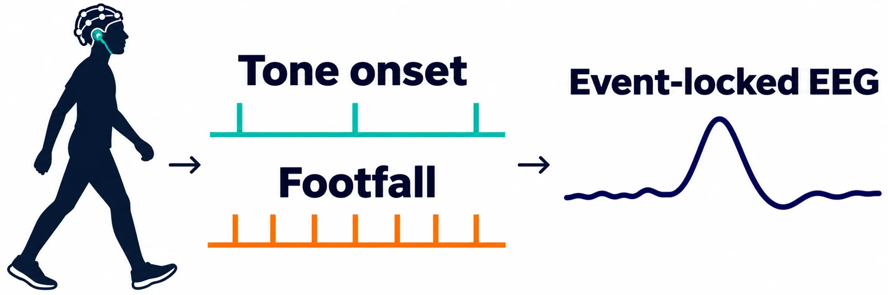
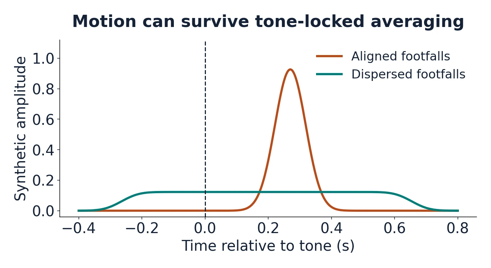
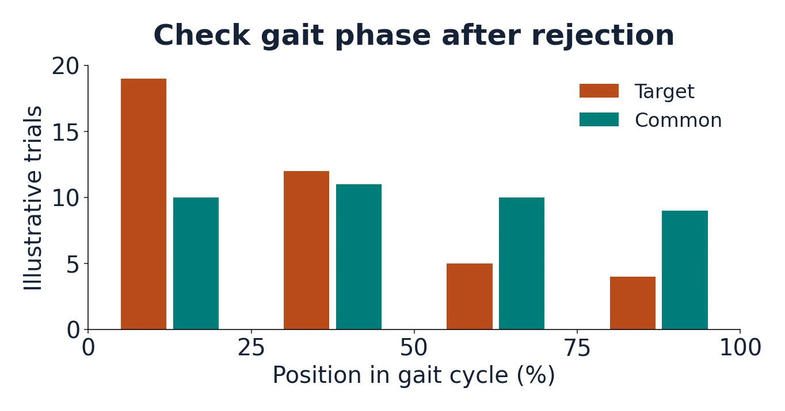

# Mobile EEG During Walking: Is the Response Locked to the Tone or the Step?

Mobile EEG can capture auditory responses during walking. Separate tone timing from footfalls to test whether an averaged waveform survives motion controls.

Imagine a participant walking down a hallway while listening for an occasional target tone. You average the EEG around the tones and get a broad positive bump. Now plot the time from each tone to the nearest footfall. If the tones tended to land at the same point in the stride, that bump may have contributions from both events. More trials will give you a more precise average of whatever the experiment actually aligned.

## Give each event its own timestamp

An event-related potential (ERP) is a voltage pattern estimated relative to an event such as a sound. In an auditory oddball task, a less frequent target tone is interspersed with more common tones. One analysis compares EEG around the target tones with EEG around the common tones. For an outdoor walking study, record the sound onset, footfalls, and any button responses as separate events.

Debener and colleagues collected auditory oddball EEG with portable wireless equipment while participants walked outdoors. Their study demonstrated that an event-related response could be measured in the context of that task and setup. It did not remove the need for movement controls when the route, equipment, or task changes. [Debener et al., How about taking a low-cost, small, and wireless EEG for a walk?](https://doi.org/10.1111/j.1469-8986.2012.01471.x).

Use observed acoustic onset when the timing hardware supports it. An application timestamp may denote when playback was requested, and audio buffers can add a delay that varies with the setup. Keep electrode signals and auxiliary sensor timestamps on a calibrated time base. Validate it at multiple points in the session so the measured delay doesn’t hide clock drift. If the participant presses a button, log that response too. Motor activity following the target can enter the target average even when footfalls are balanced.

## See what averaging does to repeated motion

Start with an illustrative artifact that peaks at each footfall. If footfalls occur at different times relative to the tones, averaging tone-aligned epochs tends to spread the artifact out. If the footfall appears at approximately the same latency on each trial, it can remain sharply visible in the mean. The figure uses the same synthetic artifact in both cases and includes no tone-evoked neural signal.

When setting up the task, inspect the distribution of stimulus phase within the gait cycle. Even a schedule with a random component can produce an imbalance after dropping bad epochs. Plot the distribution separately for accepted target and common trials. When they cover different fractions of the stride, the difference in average EEG can mix a tone effect with differences in gait phase.

Kline and colleagues devised a treadmill experiment that recorded motion artifact while blocking physiological signals and simulating a conductive scalp. In their setup, the artifact varied across speeds, participants, and electrode locations and corresponded poorly to head acceleration. An accelerometer remains a useful motion reference, but weak agreement with acceleration alone leaves other sources of motion artifact on the table. [Kline et al., Isolating gait-related movement artifacts in EEG](https://pmc.ncbi.nlm.nih.gov/articles/PMC4946867/).

## Run a tone-locked and a step-locked view

Make a tone-aligned average, a footfall-aligned average, and a tone-aligned average within comparable portions of the gait cycle. Track the accepted trial counts and the uncertainty for each view. If you require a keypress for targets, also examine a response-aligned average and compare tasks or trial subsets with compatible response requirements. A result that depends entirely on a narrow range of walking phases deserves a closer look before you interpret it as a task response.

An alternative is a regression with separate lagged predictors for tone onset, footfalls, and responses. If the events are nearly always separated by the same delay, their predictors can be nearly redundant. The model may fit the data well and still assign the same bump to different predictors under small changes in settings. Check the timing relationships before fitting and seek experimental variation when the design offers too little independent evidence.

## Preserve the measurement through preprocessing

Record rejected channels and epochs, retain the reason for rejection, and compare acceptance by condition. A stricter motion threshold can produce cleaner averages while dropping nearly all the high-speed trials. Report the resulting coverage alongside the effect and distinguish the results for seated, walking, and transition periods.

Choose filter settings with the target response in mind. Run a timing check through the entire preprocessing chain, including resampling and epoch extraction. If an offline zero-phase filter is used, examine whether a large post-event transient spreads into the baseline. For a live interface, repeat the evaluation with the same causal filters and buffers that will operate during use. The [wearable signal filtering article](/blog/wearable-signal-filtering) examines a similar distinction between a visually clean waveform and a defensible timing feature.

The next step is a replayable audit. Save a synchronized excerpt of EEG, measured tone onset, response, and footfalls. Mark the rejected segments and be able to reconstruct the event averages from those records. That makes it possible to tell whether a cleaner figure came from better signal, fewer hard trials, or a more informative experimental design.
