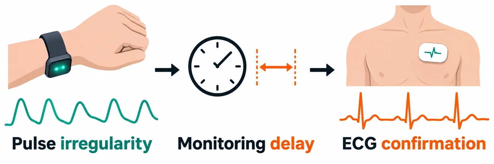
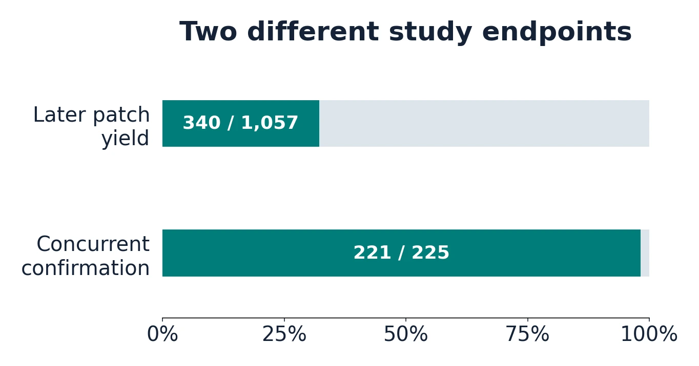
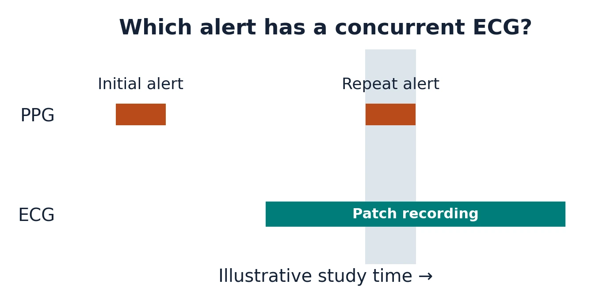

# How ECG Validates Wearable PPG Alerts for Atrial Fibrillation

Wearable PPG detects pulse irregularity. ECG validation shows how alert timing, follow-up, and study denominators affect reported AFib performance.

A watch records an irregular pulse at 2 a.m. When an ECG patch starts recording four days later, the rhythm is regular. Did the watch make a mistake? Possibly. It’s also possible the rhythm changed in those four days. The two recordings answer different questions, and how a study handles that gap matters as much as the algorithm’s threshold.

## Follow the alert from the wrist to the ECG

Photoplethysmography (PPG) measures a light signal modulated by the peripheral pulse. An algorithm can extract pulse intervals and look for a sustained irregular pattern. Atrial fibrillation (AFib) can produce irregular ventricular timing. Extra beats, a missed pulse, poor contact, and motion can also make the intervals look irregular. The optical channel gives the algorithm an observation about the pulse. The ECG provides an electrical recording on which the rhythm can be adjudicated.

*The traces are schematic. The ECG shown illustrates the recording modality, with a regular rhythm.*

Keep the pulse detector and the rhythm classifier separate when debugging. If the detector misses one pulse in an otherwise regular trace, one measured interval can span two real beats. If it finds an extra peak on the falling part of a pulse, two short intervals can replace one ordinary interval. Either failure can increase a rhythm irregularity score before the classifier sees the sequence. Plot the flagged intervals against the raw waveform and the accepted peaks. The [wearable ECG and PPG filtering article](/blog/wearable-signal-filtering) shows how motion and contact issues affect those detections upstream.

## Use the right denominator for the question

The Fitbit Heart Study enrolled 455,699 participants. Among the 1,057 who received an irregular rhythm detection and returned an analyzable subsequent ECG patch, 340 had AFib on the patch. The resulting 32.2% describes detection of AFib during follow-up in that group. The study also reported that 221 of 225 participants with another detection during patch wear had concurrent AFib on the ECG, or 98.2% positive predictive value for the first detection during monitoring. The denominators represent different groups and the endpoints involve different times. [Lubitz et al., Fitbit Heart Study](https://pmc.ncbi.nlm.nih.gov/articles/PMC9640290/).

The follow-up number is closer to the question a screening program asks when it sends a patch after an alert. The concurrent number is closer to the question an algorithm team asks about a new detection with a reference already running. Patch return also introduces selection. The participants who provide an analyzable record can differ from those who never start monitoring or whose data cannot be read. A study report should show that funnel before it summarizes agreement.

The Apple Heart Study used a related design. It reported that 34% of the 450 participants who returned an analyzable patch had AFib on the subsequent patch. Separately, the reported positive predictive value for irregular pulse notifications observed during simultaneous ECG monitoring was 0.84. Interpreting these estimates across studies requires checking the underlying enrollment, sampling, alert rules, monitoring protocol, and endpoints. [Perez et al., Apple Heart Study](https://doi.org/10.1056/NEJMoa1901183).

## Define what overlaps before counting agreement

Store the source interval the algorithm evaluated, the time it decided to alert, and the time the alert was delivered. A persistence rule can look back across a sequence of windows. If the server sends the notification minutes later, pairing the ECG to the delivery timestamp can compare the wrong interval. Use the algorithm’s evidence interval and write down in advance how much usable reference overlap a match requires.

A study can also track recurrence within a separate follow-up period. In the illustration below, there is no ECG recording during the initial irregular pulse window. The second optical event occurs while the patch is recording. That one can be compared against the ECG over the same time. The first can still contribute to an analysis of follow-up yield.

Decide how to count repeated detections. Twenty windows from one prolonged episode can dominate a window-level metric while contributing one episode or one participant to another analysis. Declare the aggregation level, episode-merging rule, overlap requirement, and handling of unreadable reference intervals. Estimate uncertainty with participant-level resampling when measurements repeat within people.

## Measure where the watch had a chance to see the rhythm

Intermittent optical sampling and quality gates change the intervals the device can evaluate. A detector that primarily evaluates still periods may perform well when it reports and miss episodes during activity or periods when the watch is off the wrist. If you have continuous reference ECG for a validation subset, report detection both within eligible periods and across the full monitored period. The gap between the two estimates tells you how much acquisition and quality rules constrain surveillance.

For each participant, account for scheduled wear, recorded PPG, PPG that passed the quality rule, concurrent analyzable ECG, and intervals with enough history for alert logic. Where the reference permits, calculate the fraction of adjudicated episodes that fell outside eligible intervals. A study that acquires ECG only after selected participants receive alerts cannot use that follow-up sample to estimate sensitivity across the original cohort.

## Make the handoff testable

Before interpreting pooled metrics, trace one case from end to end. Open the original pulse waveform, examine the detector’s accepted and rejected peaks, check the evidence window and alarm timestamp, and inspect the reference recording and adjudication. Record whether the ECG was simultaneous, delayed, or unavailable. The same labels should appear in the event table and the analysis.

That trace can reveal where a system is failing. When most unpaired events occur before a patch arrives, changing the pulse threshold won’t fix the reference gap. When the ECG is present and errors cluster around missed PPG peaks, there is a specific upstream failure to investigate. A wearable study becomes much easier to interpret when the report makes those two cases visible.
