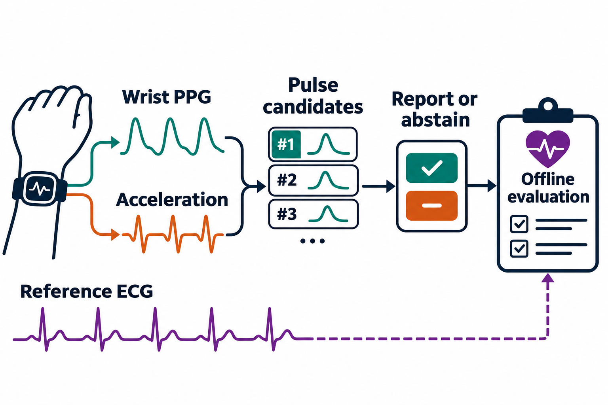
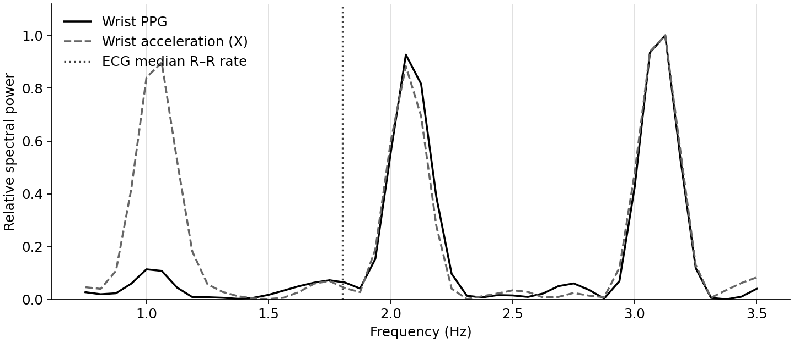
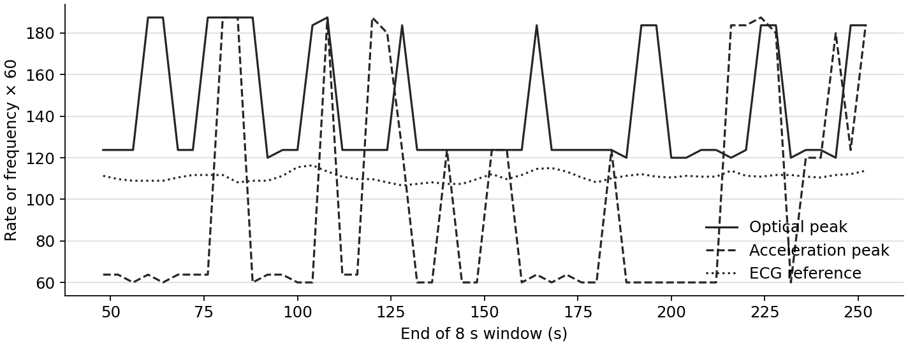

# Can a PPG Foundation Model Tell When It’s Following Your Stride?

I ran a peak-picking baseline on a treadmill recording where wrist movement and the optical pulse shared the same measurement. The strongest optical peak came out near 188 cycles per minute, while the chest ECG put the heart rate near 108 beats per minute. I traced that gap back to the recorded wrist channels and compared what the baseline saw at different window lengths.

## 1. Align the wrist and chest recordings

I used the public `s3_run` recording from Jarchi and Casson. I unwrapped the wrist timestamps at the minute boundary, set the first valid wrist timestamp to zero, and interpolated the selected wrist interval onto a uniform 256 Hz grid. I used the ECG sample rate and annotated R-peak indices for the chest reference. That alignment supports a comparison across windows. I used the chest ECG only to estimate reference rate for the comparison.




[Wrist PPG During Exercise dataset](https://physionet.org/content/wrist/1.0.0/) · [Recording and annotation protocol](https://doi.org/10.3390/data2010001)

## 2. Run the strongest-peak baseline

I scanned eight-second windows starting every four seconds from 40 through 248 seconds. I selected the 76–84 second interval because the PPG and wrist X-axis peaks agreed while the ECG-derived heart rate was far away. I used a Hann-windowed periodogram and selected the strongest peak between 0.7 and 3.5 Hz.

```python
import numpy as np
from scipy.signal import periodogram

def in_band_peak(samples, fs, low_hz=0.7, high_hz=3.5):
    if len(samples) < 2 or not np.isfinite(samples).all():
        raise ValueError("Need an uninterrupted finite signal window")
    freq, power = periodogram(
        samples, fs=fs, window="hann", detrend="linear",
        nfft=max(len(samples), 4096)
    )
    eligible = (freq >= low_hz) & (freq <= high_hz)
    if not np.any(eligible) or np.max(power[eligible]) <= 0:
        raise ValueError("No spectral evidence in the specified band")
    peak_hz = freq[eligible][np.argmax(power[eligible])]
    return peak_hz, freq, power
```



I found the same strongest peak in the PPG and acceleration spectra: **3.125 Hz**, or about **188 cycles per minute**. When I calculated rate from the median interval between annotated ECG R peaks, I got about **108 beats per minute**. Seeing that gap alongside the shared wrist peak helped me identify movement as a plausible explanation. The acceleration measurement is wrist movement along one axis, so I did not use it as a direct footfall count.

## 3. Change the window length and check the other axes

I recomputed the optical spectrum on the last two, four, and eight seconds ending at the same time. I also plotted the three accelerometer axes for the eight-second window. I normalized each curve by its own in-band maximum to compare peak locations and shapes. Those plots use relative power, so the curve heights do not compare absolute signal strengths across axes or durations.


## 4. Put the example back in the run

I plotted the strongest optical and X-axis peaks alongside the ECG-derived rate across the overlapping windows. The timeline puts the selected failure next to the surrounding estimates and shows where the curves separate. Where the optical and ECG rates coincide, the plot shows agreement without identifying what produced the optical peak.



I could see exactly where the baseline went wrong in this example. It picked the strongest optical frequency, and I found that same frequency in the wrist acceleration. Putting the spectra beside the ECG reference helped me explain how the baseline arrived at 188 even though the reference rate was near 108.
