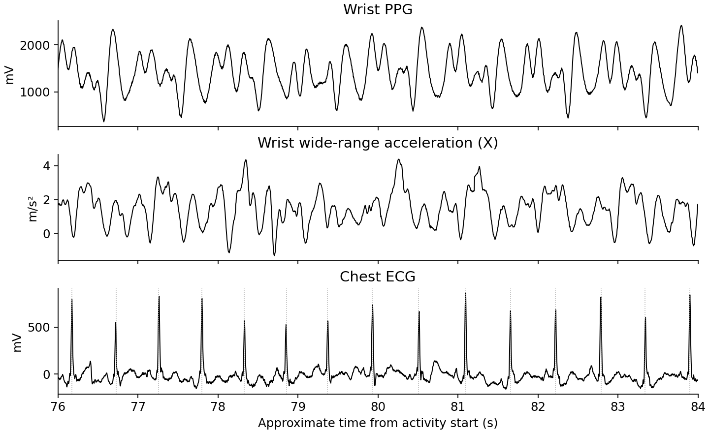
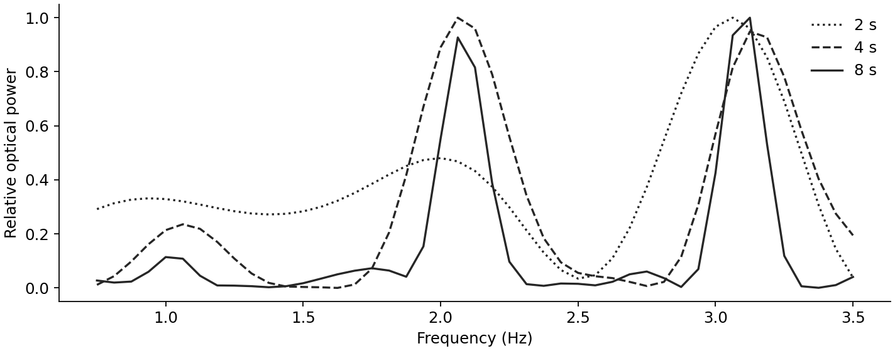
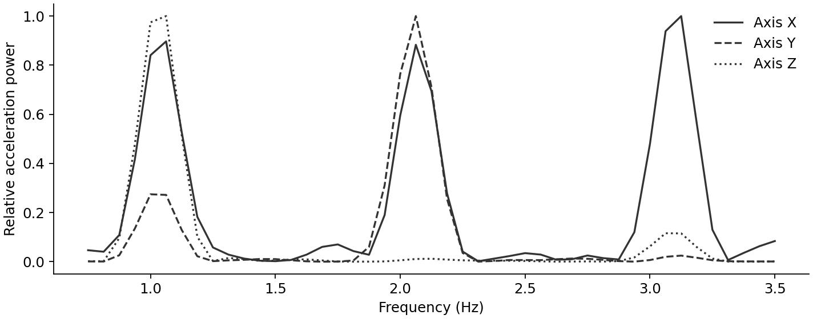

# Can a PPG Foundation Model Tell When It’s Following Your Stride?

A watch can give you a number that stays steady through an entire run. That sounds like a good sign until you compare it with a chest ECG and realize the number was closer to your arm swing than your heart rate. An optical signal can be strongly periodic for more than one reason. A smooth display can make the wrong explanation look convincing.

This makes for a sharper foundation-model experiment than asking whether pretraining improves average heart-rate error. Can a model tell when the strongest optical component is the wrong one? And when the evidence is genuinely ambiguous, can it say so without giving up on every difficult window? We'll look at an actual running recording, build a baseline you can inspect, and design the test around those questions.


## 1. Look at a real run on two clocks

The wrist optical channel responds to blood-volume changes and the conditions under which light travels into and out of the tissue. Motion can change those conditions. The accelerometer responds to movement of the sensor, giving you a second measurement that may explain some of the optical interference. A chest ECG gives us a separate electrical reference. It is particularly valuable here because a model can produce a strong periodic estimate even when the optical pulse is hard to recover.



The record is from Jarchi and Casson's public exercise dataset. The reference R peaks were marked on the chest ECG, while the wrist package acquired optical and motion data. The two devices' alignment is estimated using timestamps. That's sufficient provenance for a window-level illustration, and I'd validate alignment separately before interpreting a beat-by-beat delay. The acceleration panel shows an axis of wrist movement rather than a direct footfall count. [Wrist PPG During Exercise dataset](https://physionet.org/content/wrist/1.0.0/) · [Jarchi and Casson, original data paper](https://doi.org/10.3390/data2010001)

If you looked only at the optical trace, you could interpret the repeating pattern as the pulse. Put the wrist motion next to it and there is a second plausible explanation. Put the ECG underneath and you have a way to test that interpretation. These are three different observations. The optical channel is the thing we're trying to estimate from. Motion adds context. The ECG lets us score the outcome independently.

Practical distinction: an acceleration frequency can represent an arm-motion component or a harmonic, and it doesn't have to equal step cadence. I'll use *cadence lock* as shorthand for following a periodic movement component. When the experiment requires actual steps per minute, use an independently validated step reference or label the reported quantity as a wrist-motion frequency.

## 2. Reproduce the baseline failure

Use the same window for every method. Get an optical spectrum and one spectrum per acceleration axis. For a basic inspection, detrend each signal and apply a Hann taper. Inspect all three axes before forming a summary. A vector norm can be convenient, but it is a nonlinear transformation and can change which harmonics dominate. One axis can provide a clearer reference for a particular movement, while a different axis dominates after the wearer rotates the wrist.


In the selected 76–84 s interval, the strongest in-band peak in both the optical trace and the plotted acceleration axis falls at **3.125 Hz**, equivalent to about **188 cycles per minute**. The annotated ECG's median R–R interval gives about **108 beats per minute** in the corresponding interval. The example was selected from eight-second windows starting every four seconds from 40 through 248 seconds in this record to show a large separation between the optical peak and the ECG estimate when optical and motion peaks were close. It illustrates a plausible movement-related failure of the peak picker without estimating how often it occurs.

The wrist's time channel wraps at one minute. For these figures I unwrapped it, set the first valid wrist timestamp to zero, and interpolated the selected wrist interval onto a uniform 256 Hz grid. The ECG time base uses the record's nominal rate and annotation indices. This follows the dataset's approximate activity alignment. The selected PPG peak differs enough from the ECG rate to make the candidate-selection problem visible at window scale. Beat-to-beat attribution would need a tighter alignment study.

The plot gives you a candidate-selection test. A peak picker would take the largest optical component in a plausible band. A motion-aware tracker has another cue: some prominent optical energy is also present in the motion channel. The reference ECG provides a third check. Even when the two optical and acceleration peaks are close, spectral agreement alone cannot prove how much optical power came from motion. Rate and cadence can coincide, and some interference is only weakly captured by acceleration.

Use the following helper to reproduce the spectrum on uniformly sampled arrays. For the wrist channels, interpolate from their recorded timestamps onto a common grid before calling it if the timestamps are irregular. Use a specified wrist axis for a simple check, or run it independently on each axis. The dense frequency grid can help visualize the peak locations. The observation duration and the signal within it still limit how well nearby components can be resolved.

```python
import numpy as np
from scipy.signal import periodogram

def in_band_peak(samples, fs, low_hz=0.7, high_hz=3.5):
    if len(samples) < 2 or not np.isfinite(samples).all():
        raise ValueError("Need an uninterrupted finite signal window")
    freq, power = periodogram(
        samples, fs=fs, window="hann", detrend="linear",
        nfft=max(len(samples), 4096)
    )
    eligible = (freq >= low_hz) & (freq <= high_hz)
    if not np.any(eligible) or np.max(power[eligible]) <= 0:
        raise ValueError("No spectral evidence in the specified band")
    peak_hz = freq[eligible][np.argmax(power[eligible])]
    return peak_hz, freq, power
```

A useful exercise is to shorten the window around the same end time. Do the candidate peaks stay in the same place? Do they broaden until the two explanations look indistinguishable? Then move the window by a few seconds and watch the candidate ranking change. That is the part of the problem a live device has to navigate. A result from one long, stable section can conceal what happens in transition windows.

TROIKA offers a strong historical point of comparison. The authors combined signal decomposition, sparse spectrum estimation, and peak tracking with verification during intense exercise. Their approach demonstrates why you would want a tracker with more context than the dominant spectral bin. A new experiment should compare to a competent motion-aware implementation and to simpler baselines that reveal what each ingredient adds. [Zhang, Pi, and Liu, *TROIKA*](https://arxiv.org/abs/1409.5181)

### Test whether a cheap motion rule can already solve the window

Try the simplest obvious rule on the plotted example. Mask optical candidates near a strong motion peak, then choose the best of the remaining optical candidates. See if the surviving peak is close to the reference. This experiment is useful even if the rule fails. It can show that the challenge is recovering a weak pulse candidate, rather than merely identifying a strong motion component. It also forces you to put a reasonable rule-based comparison beside the foundation-model arm.

Now reverse the conditions. Find a window where the reference heart rate sits near a movement peak. A blanket veto can discard a valid estimate. A more capable tracker should retain the candidate if other evidence supports it. Run both cases with thresholds fixed on a development participant, and show how a motion cue changes the candidate ranking for each window. If the foundation encoder does no better than the veto on either case, that tells you where the next model change should go.

Try a local search around a previous estimate as another control. It often stabilizes candidate selection when the heart rate changes slowly. The same search can lag a rate transition or preserve an incorrect initial lock. Initialize every method from the same information and compare cold-start cases separately. An algorithm given a guaranteed good initial pulse has an easier starting condition than one asked to recover after the strap settles.

For a paper, I'd include the full candidate list at a small set of labeled disagreement windows. Show the rank using PPG alone, the rank after adding acceleration, and the final rank after adding the encoder features. That makes it clear whether a model found a candidate that the simpler system never proposed, chose a better one from the same candidates, or simply became more willing to decline a weak estimate. These failure categories suggest different next changes.


### See what a shorter window does to the evidence



All three inputs end at the same instant. Shorter windows have fewer cycles and typically broader peaks under the same type of taper. The exact peak locations can also change because every window contains a different slice of a moving signal. Plotting all spectra on a dense grid makes alignment easy to inspect. It doesn't manufacture the frequency resolution you would have obtained by observing more time.

A real tracker has to trade that evidence against lag. A long trailing window can preserve the old rhythm even as the new rhythm becomes visible. A short one can be responsive but jump between credible candidates. Try maintaining a long spectrum for candidate generation and using recent evidence to update confidence. Compare it to a short-only tracker with the same inference budget. If the long component holds onto the wrong explanation during a transition, the timeline will show which samples the system was reacting to.



Figure 5 makes the axis choice explicit. In the first example we plotted the X axis because it supplied the movement peak used for the comparison. Axis-wise normalization reveals where each axis concentrates power. It hides differences in total energy, so copy the raw variance or power into any rigorous selection rule. A flat but normalized spectrum can otherwise look as influential as a strong, clean periodic measurement.

For deployment, establish whether you pick the axis with the most reliable signal in that window or use a multichannel feature. A rule that takes the nearest peak from any axis may produce false matches simply because it had more chances. Evaluate it against a fixed-axis baseline and inspect windows where the wrist orientation changes. A candidate scorer can then use motion as evidence with a known strength.

## 3. Define what counts as cadence lock

A bad rate estimate during movement isn't always cadence lock. The optical input might clip, the device might lose contact, the tracker might select a pulse harmonic, or the window might straddle a true rate change. I would reserve the label for a combination of observations: the estimate is close to a supported movement component, it differs materially from the ECG-derived reference, and the pattern persists long enough for the term *lock* to make sense.

Set those tolerances on development data. Use independent participants for testing. Decide what to do when the ECG and motion frequencies are so close that both explain the estimate. Those windows can test confidence and coverage, but claiming a definite source for a correct-looking estimate is generally harder. Treat the question of rate correctness and the question of mechanism as distinct annotations.

| Window category | How to recognize it | What I’d report |
| --- | --- | --- |
| Little motion | Low movement under a declared criterion | Baseline rate error and reporting coverage |
| Movement near the reference rate | Motion and reference candidates fall within the declared overlap threshold | Whether methods keep correct estimates without excessive abstention |
| Movement separated from reference rate | An independently supported motion peak differs from the ECG-derived rate | How often wrong estimates follow the movement peak |
| Transition or recovery | Activity or signal quality changes during or near the window | Time to lose a stale lock and time to regain a valid estimate |
| Low-quality reference | Reference ECG cannot support a reliable rate estimate | Exclusion count and reason |

A persistence criterion matters because motion spectra are noisy and movement changes. One accidental near-match can happen by chance. A sequence of wrong windows tracking a movement ridge is a more useful example. When windows overlap, calculate episode duration on the wall-clock timeline, rather than treating each repeated estimate as a separate independent failure.

Define the reference rate using the annotated ECG beats in the relevant interval. A median of valid R–R intervals is one option for a stable window. For rapid transitions, decide whether to compare with an instantaneous reference or a summary on the exact trailing window. Keep that rule identical across methods. Otherwise an estimator built to smooth can appear to lock onto the wrong signal when the reference and output simply refer to different time ranges.


### Put the selected example back into the run


A single window can be persuasive precisely because someone picked it. Figure 6 uses four-second steps over a wider part of the same recording, with no candidate smoothing. Follow the dashed acceleration curve and see where the optical curve moves with it, then compare both with the dotted ECG reference. When the optical estimate jumps away for one window and returns, that's a different failure from a persistent episode.

The reference here is the median interval between annotated R peaks in each corresponding ECG window. The motion series is an axis frequency scaled to cycles per minute and should not be interpreted as a confirmed step-rate measurement. When the two series coincide, the plot can only show agreement. It cannot identify the optical source. For an episode-level analysis, use the association rule from Step 3 and retain the gap categories as well as any high-confidence locks.

I'd take one transition where the curves separate and write out the top candidates at each step. Inspect the rank, power, harmonic relationships, and recent history. If the correct candidate is absent from the shortlist throughout the episode, a better learned ranker won't fix it. If the candidate is present but loses to the motion peak, ranking is the right target. If the candidate changes too rapidly for a stable decision, calibrated abstention may be the safer design.

### Reconstruct the evidence at evaluation time

For each reported estimate, save the window start and end, candidate frequencies, selected candidate, confidence, and reason if withheld. Keep the ECG annotations outside that log until offline comparison. With those fields you can recreate the timeline and see where the method changed state. It is hard to debug cadence lock after recording only a final rate value per minute.

I’d include a second postprocessing comparison with exactly the same candidate predictions. One path reports immediately, a second uses hysteresis, and a third also requires consistency over several windows. This separates evidence selection from presentation stability. If a foundation model seems to improve recovery, verify whether it made better candidates available or whether its confidence triggered a different reporting policy. Readers should be able to reproduce the difference from the saved predictions without training the model again.

## 4. Add a foundation model without hiding the baseline

PaPaGei provides a pretrained PPG encoder with morphology-aware representation learning. I'd begin with the frozen features and ask whether they improve either candidate selection or the decision to report. Avoid making the first version an end-to-end network with an opaque output. If the result improves, it should be possible to see which behavior improved. [Pillai et al., *PaPaGei*, ICLR 2025](https://proceedings.iclr.cc/paper_files/paper/2025/hash/7871f51d332c8661cc729539d7987b21-Abstract-Conference.html)

A useful setup starts with a common proposal stage. Generate a small list of optical candidates with their peak heights, neighboring energy, harmonic support, and continuity cues. Give each candidate the same motion features, such as distance to an acceleration peak. Then compare the candidate scorer with and without a pretrained PPG embedding. That isolates the question. A model that also sees more candidate context or a longer window can win for reasons unrelated to pretraining.

I'd keep at least four variants. The first is the plain peak picker. The second is a tuned conventional candidate scorer or tracker that sees PPG and acceleration. The third has the same candidate pipeline with a trainable or randomly initialized PPG encoder under a comparable downstream budget. The fourth adds the pretrained PPG representation. If feasible, separate frozen and fine-tuned cases. Make sure the control uses a valid learning setup. A fixed random projection alone tests a different question from an encoder learned from scratch.

Decide how much history each candidate gets. A tracker with a long memory can bridge short corruptions, but it can also cling to the previous estimate during a real rate change. Give the learned model and conventional baseline equal access to past data for the primary comparison. If you include a bidirectional offline model, show that as a setting with future samples available. A wearable producing a live estimate does not have that information.

The reference ECG belongs on the evaluation side. It can produce labels during training and evaluation, but the deployed model in this experiment sees only wrist inputs. Make sure no cached quality measure, window acceptance rule, or feature derived from chest ECG enters inference. It's easy to accidentally make the problem easier by using reference annotations to choose which windows a model sees. Define reference eligibility for reporting error and model eligibility for making a decision as two distinct steps.

## 5. Make accuracy and coverage share a plot

If a model can decline to report, average error on accepted windows will usually tell only part of its story. A method can avoid almost every severe artifact by accepting only the easiest cases. That may be acceptable for some uses and frustrating for an exercise display. Plot mean or median absolute error against the fraction of **reference-eligible** windows reported. Show both metrics at a few operating points chosen on independent development data.

Then break the curve out by condition. If the gain comes exclusively from quiet windows, it doesn't answer the cadence research question. If it comes from near-overlap windows and coverage stays useful, inspect those windows to see whether better confidence or better selection explains it. Report participant-level uncertainty. Several hundred overlapping test windows from one runner are not several hundred independent people.

I'd add three panels to the results. One panel gives the curves at matched reporting coverage. The second gives episode length for cadence lock, using the rule you declared before evaluation. The third follows a few prespecified transitions and stacks the ECG reference, the optical and acceleration spectra over time, and the accepted or withheld model estimates. That view makes it possible to see whether a method got the rate right, held the last value too long, or stopped reporting while evidence was weak.

This is also where a model can fail in a more subtle way. It can learn that high movement usually means low confidence and decline during all exercise. Such a model could achieve a clean-looking accepted-error score while adding little value to the task. Include the acceptance rate in a motion-heavy cohort with good reference data, and show both successful and failed high-motion examples. If a genuinely good estimate is frequently discarded, label it and study why.

The most interesting comparison for me would look across activities and then across devices. A treadmill experiment provides an explicit source of sustained periodic interference. Daily-life recordings add starts, stops, rotations, and less periodic motion. PPG-DaLiA provides paired chest ECG, wrist optical signals, and accelerometry across daily activities, making it a useful second setting. Verify the sampling and reference definitions when moving across datasets. [Reiss et al., *Deep PPG* and PPG-DaLiA](https://doi.org/10.3390/s19143079)

### Test the reporting policy on a new session

An accuracy-versus-coverage comparison can change once you move from one session to another. A confidence threshold selected on steady treadmill running may fire far too often when a person is climbing stairs, turning, or checking the watch mid-stride. Keep the same threshold for the principal transfer result. If you also tune for the new device or activity, report the local tuning sample and show how much that changes the result.

A small external study is easier to interpret if the cohorts share a common reference. If one uses annotated ECG intervals and the other substitutes rate from a second monitor, the labels can differ in smoothing, timestamp, and artifact handling. Try to recreate the same interval estimate from the ECG in both datasets. Reconcile rates only across windows supported by the reference, while reporting overall reference and tracker availability separately.

There is an especially useful negative control. Run the quality head on low-motion windows where the optical morphology changes for reasons other than movement. If it declines there, the encoder may have learned the appearance of a familiar waveform rather than the reliability of the candidate. Compare that against motion-heavy windows with a clearly supported pulse. In both cases, inspect the phase and rate consistency rather than assigning quality from activity alone.

Finally, decide what an acceptable recovery looks like. A system that resumes reporting two beats after motion subsides is more responsive than one that waits two full windows, but it has less evidence. In a live experiment, compare policies using the actual timestamps of emitted estimates, not recomputed labels on retrospectively centered windows. That gives you the cost of waiting in the same units as the benefit.

## What would count as a discovery?

If pretraining improves candidate ranking at the same coverage, and the advantage persists on people and acquisition conditions kept out of fitting, that would support a useful representation. If it only improves the abstention score, that is still a meaningful result. A quality assessor can be worth deploying even when the pulse estimator itself remains conventional. If the advantage disappears once the comparison uses a strong motion-aware baseline, that tells you where the easy gains came from.

I'd also inspect whether an encoder changes which ambiguous beats it discards. A model may smooth through an abrupt rate change because it learned that past continuity is usually reliable. Add transitions in which the reference really changes while wrist motion stays relatively steady. A convincing model should handle both kinds of disagreement: cases where the optical tracker follows movement and cases where a real change makes the optical trace look temporarily unfamiliar.

The measured recording in Figures 2 and 3 provides a concrete running example and a reproducible spectral comparison. A multi-participant model benchmark would answer how often that mechanism occurs and whether pretraining helps. I'd keep the one example in the paper even after adding the aggregate charts. A reader should be able to see why the strongest peak was tempting, then see whether the system had enough evidence to move away from it.

A useful paper figure would show both false confidence and healthy uncertainty from the same test set. When the tracker withholds, show the competing candidates and the input quality flags beside the ECG reference. The reader can then distinguish a defensible decision to wait from an estimator that simply failed to follow a visible pulse during a difficult activity.

[PhysioNet platform citation](https://doi.org/10.1038/s44360-026-00096-z)

---

**Previous in the series** · [Do ECG and PPG Foundation Models Learn the Heart or the Device?](/blog/biosignal-device-shortcuts)

**Next in the series** · [How Much ECG or PPG Does a Foundation Model Actually Need?](/blog/biosignal-window-length)
