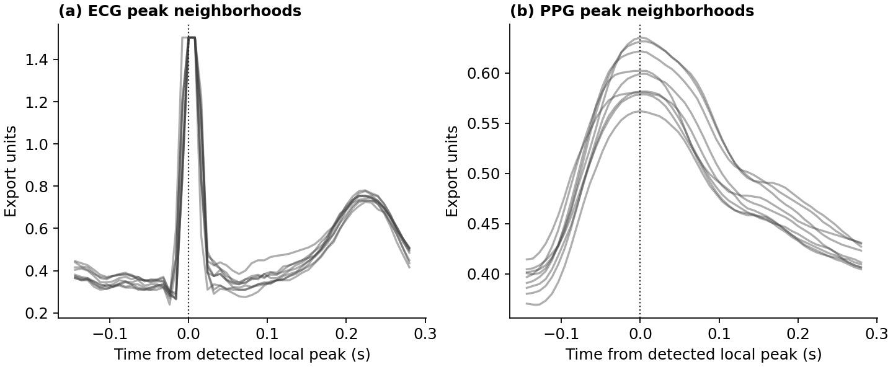
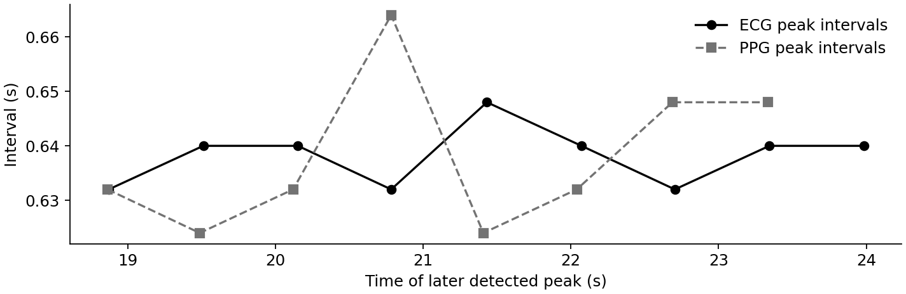
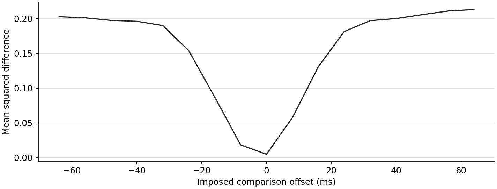

# What Can PPG Tell You About an ECG It Never Recorded?

Suppose you hide the ECG channel from a model and give it only the optical pulse. The generated ECG has sharp complexes, a steady baseline, and a rhythm that looks convincing. Would you trust it to reproduce the one beat where something changed?

That's the experiment I'd want to see. Getting the rate right and drawing a plausible waveform are worthwhile achievements. The harder question is whether the pulse contains enough information to recover the electrical details of **this beat**, in **this person**, under **these recording conditions**. A model can succeed at the first job while failing the second.

We'll start with real synchronized traces, build a control that keeps the person and rate approximately fixed while breaking the exact pairing, and work through what the results would mean. The plots use public recordings. The proposed training comparison is an experiment design.

## 1. Look at what the two sensors actually measured

The ECG records differences in electrical potential between electrodes. A plethysmogram records optical changes associated with pulsatile blood volume at the sensor site. A ventricular electrical event can produce a pressure wave that reaches the periphery, so the two recordings carry related timing information. The shape of that optical wave also depends on mechanical and vascular processes along the way. The two sensors see different parts of the sequence.


Look at a few repeatable cycles in Figure 2. There is an obvious rhythm in both traces. Now look closer. The sharp electrical complex is brief, and the optical pulse rises and falls over a visibly different time scale. Before reading a delay from this figure, you'd need a consistent beat pairing, a choice of fiducials, and evidence about the channel timing. These are monitor exports from a public hospital dataset. The displayed values retain the CSV scale. [BIDMC dataset and recording protocol](https://physionet.org/content/bidmc/1.0.0/) · [Pimentel et al., original study](https://doi.org/10.1109/TBME.2016.2613124)

That difference in what the sensors measure is a useful way to organize the tasks. Estimating a rate asks for the periodic component. Estimating an electrical landmark asks for an event time. Reconstructing a full trace asks for a sequence of amplitudes, deflections, and intervals, many more degrees of freedom than a rate. I'd score those tasks separately from the beginning. If the model does well on rate and poorly on shape, one average score shouldn't turn that into a middling result. It should reveal where the information seems to run out.

Two kinds of systems also get grouped together under PPG-to-ECG. One generates an ECG-looking signal from a PPG segment. The other uses ECG during training to teach the PPG encoder something useful, then throws away the ECG branch at inference. Latent alignment can help a classifier without producing a trustworthy reconstructed trace. A recent study investigated both ECG-constrained PPG representation learning and PPG-conditioned ECG generation. It supplies a precedent for separating the downstream classification and waveform questions in the evaluation. [Primary study on PPG–ECG alignment and generation](https://www.nature.com/articles/s41746-025-02228-3)

### A small experiment you can do before training

Detect repeatable peaks in the two channels independently and stack short pieces of each signal around its own peaks. This deliberately removes the relative timing between modalities. What remains is the local shape in each channel. On a regular segment, you can see how quickly the electrical signal changes near its peak while the PPG pulse presents a much broader structure. The two panels are a visual argument for keeping shape and timing separate throughout the study.



Use lead II values above 1.1 export units and a minimum separation of 50 samples to locate the ECG candidates for this one segment. For PPG, use peak prominence of 0.07 export units and the same separation. The plotted neighborhoods extend from 18 samples before to 35 samples after each accepted center. These are inspection settings for the chosen trace. If you repeat the exercise on a new recording, inspect every accepted and rejected candidate before using the result. A detector calibrated to one export scale can fail as soon as gain or polarity changes.

Next ask yourself what a template can get right. Center the ECG neighborhoods, take a median across training beats, and overlay it on a separate beat from the same distribution. The resulting trace can plausibly resemble an ordinary complex without being inferred from that beat's PPG. Try scoring that template twice, first placing it by an input-only timing rule and then aligning it to the reference peak for a shape-only score. The gap between those scores is a reminder that a reconstruction metric can move simply because you changed how waveforms were lined up.

The plots come from a monitor excerpt with regular-looking cycles. For a real test you need enough independently annotated examples of the feature you claim to recover. If the rare category appears only in a few patients, an impressive per-beat count can obscure the narrow evidence base. Write down the eligible patients and sessions beside the beat count. Keep a manual review sample for the reference labels as well as for the model outputs.


### Compare the intervals before comparing the shapes



In Figure 4, compare the height and spacing of the two series. When the intervals are similar, a rate model has a real signal to work with. There is no one-to-one matching assumption in this figure. The detector operates independently on each channel with the same settings used for Figure 3. The interval values describe one selected excerpt and help explain why broad rate agreement can coexist with large differences in local waveform geometry.

There is also a question of which peaks you keep. A weak optical pulse can fall below a prominence threshold, so two electrical beats can become one long optical interval. A motion spike can create the opposite error. For the experiment, I’d save peak candidates rejected by the detector, including their reasons. If generation gaps cluster there, investigators can distinguish a modality limitation from a failure of the specific optical detector or segmentation implementation.

Try rerunning the plot after widening the optical detector's minimum separation. Does it drop a real pulse, or just eliminate a secondary local peak? Compare the result against the original trace. In the larger study, reference labels or independent adjudication should guide this check. For the tutorial, the goal is to see how a preprocessing decision changes the evidence the model has access to.

## 2. Decide what the model has to beat

Imagine the training set contains hundreds of windows from each patient. If the ECG shapes are fairly stable within a patient, a model may learn a recognizable template. Give the model a regular pulse sequence and it can place copies of an appropriate-looking template at plausible intervals. That output may look strikingly good on a montage of ordinary beats.

Now imagine the one window that matters contains an unusual beat or a transient change in conduction. A template generator trained to minimize average error has a reason to smooth it out. Returning the typical waveform can score better over many ordinary samples and still miss the unusual event. If every example in the figure is well behaved, the reader never sees where the model relies on the template.

I'd start with three controls, each designed to retain a different amount of information.

| Training condition | Information preserved | Question it answers |
| --- | --- | --- |
| Time-aligned ECG and PPG | The actual paired window, with checked temporal alignment | Does exact pairing help recover or encode something beyond shared context? |
| Same-person, rate-matched shuffled ECG | Person, approximate rate, and selected recording conditions | How much of the apparent gain can stable morphology and rate explain? |
| PPG-only representation | Optical waveform, trained without ECG targets | Does ECG guidance improve the downstream result over optical pretraining? |
| Rate-conditioned ECG template | Rate and a simple reference morphology | How far can a low-complexity baseline go on the generation scores? |

The template deserves a fair shot. Estimate its morphology from the training fold and condition it on the same information that will be available at inference. If a personalized template uses a previous ECG from the test person, report that as a different setting. A deployment with a historical ECG and one with only a wearable pulse have different information available.

For an embedding experiment I'd hold the PPG encoder architecture and optimization budget fixed where possible. I'd give the paired and shuffled models the same PPG segments in the same train folds. For a generation experiment I'd use the same decoder, output length, and alignment policy. Changing the loss and capacity at the same time as the pairing would make it hard to know which ingredient moved the score. I'd also report how a strong supervised baseline performs so the article can distinguish a genuine transfer benefit from a gain over a deliberately weak comparator.

## 3. Build the shuffle without giving the answer away

Randomly permuting ECG windows across everybody is an easy control to implement. It's also too easy for the original pairing to beat. The wrong window will often have the wrong patient, rate, and activity. Exact pairing then gets credit for several kinds of matching at once, even when the optical signal adds little about individual beats.

Instead, start by defining the eligible input windows and splitting by patient. Inside each **training** patient, search for a partner from a non-overlapping interval. Match the reference rate within a declared tolerance and, where metadata supports it, constrain the device, activity or recording context. Keep candidate selection reproducible with a recorded random seed. Count the anchors that have no eligible match. If those windows are discarded, train the matched paired comparison on that same subset as well. Otherwise the paired model may simply see a wider range of rhythms or more difficult windows.

Here's the core selection rule for a small prototype. The caller passes rows from a single training patient, each carrying a recording ID, context, start and end time within that recording, and reference heart rate. The time guard also separates immediately adjacent windows in the same recording.

```python
def choose_control(anchor, patient_windows, rng, rate_tol=3, gap_s=10):
    candidates = []
    for window in patient_windows:
        if window["id"] == anchor["id"]:
            continue
        if window["context"] != anchor["context"]:
            continue
        if abs(window["rate_bpm"] - anchor["rate_bpm"]) > rate_tol:
            continue

        same_recording = window["recording"] == anchor["recording"]
        separated = (
            window["end"] + gap_s <= anchor["start"]
            or anchor["end"] + gap_s <= window["start"]
        )
        if same_recording and not separated:
            continue

        candidates.append(window)

    return rng.choice(candidates) if candidates else None
```

If a different recording comes from the same long acquisition session, check whether it overlaps in absolute time before treating it as independent. If the cohort has medication changes, multiple visits, or sensor changes, matching more tightly might reduce the number of eligible controls. I'd show the matching rates and the distributions of rate differences for each subgroup. A control that barely represents the very cases we're studying changes the interpretation of the experiment.

There's another subtlety. The pair statistic you're destroying depends on the architecture. In waveform generation, shuffling can remove beat phase as well as morphology. A paired model could win because it puts the complexes in the right places, even if their shapes are generic. Add a stronger comparison that places a training-only template at beats detected from the input PPG, with any global timing correction fit on training data. Also score morphology after a declared beat alignment, alongside timing scored on the unshifted time base. That gives you a way to tell a well-timed template from genuinely better morphology.

For latent contrastive training, a batch can contain several windows from the same patient. Treating every other window as a negative makes the encoder separate samples that share useful cardiac traits. Decide whether those are useful hard negatives, ambiguous negatives, or examples that should be excluded from the denominator. Apply that choice equally across the paired and shuffled comparisons. Changing negative sampling can shift what the representation learns, even when the positive pairs stay the same.


### Give the reconstruction metric an easy test


The dashed trace in Figure 5 was made without using PPG. It uses the median of the other aligned ECG snippets and compares against the last eligible local beat. The optical signal plays no role, and the reference peak is used for alignment. This is a demonstration of how ordinary morphology can be easy to imitate in one stable excerpt. A train/test benchmark must construct its template from the training fold under the declared inference setting.



Figure 6 asks how much the score moves when the shape is fixed and only the comparison offset changes. At 125 Hz, the shifts advance in eight-millisecond steps. Every comparison uses the same central template support, so the score cannot improve by masking more samples at one end. The purpose is to catch an evaluation bug before training a model. If the score responds strongly to small shifts, report a separate morphology score with a clear alignment rule.

I’d keep the imposed-shift test in a regression suite. Repeat it on a few beats with different shapes, then try shifting only the ECG baseline or changing amplitude. That tells you what the metric is sensitive to before an architecture change gets credit for improving it. For example, if amplitude normalization makes every reconstructed beat look roughly similar to the target, it may be appropriate for shape but unusable as evidence that absolute ECG voltage survived.

I'd also keep a matched difference between an ordinary beat and a truly atypical example in the final evaluation. Pick it based on reference annotations before looking at the outputs. Align both by the same fiducial and inspect what each comparator retained. If the visually different feature also matters to a downstream electrical measurement, evaluate that measurement directly. A complete waveform is an attractive output, but it needs distinct evidence for the features you intend to use.

Before showing an intervention as a result, freeze the supporting table. List the exact window, which label records apply, what inference information each method sees, and how coverage is scored. The table makes it possible for somebody to explain why a single trace is a demonstration while a predeclared set of annotated comparisons supports an inference about the model.

## 4. Score beat timing and waveform detail separately

Start with a common grid. Keep track of recording timestamps, resampling, and any channel-specific latency you can establish. If the results include sample-level error, declare how the recorded ECG and generated ECG are aligned. A method that optimizes a separate shift against the reference for every test beat can report shape agreement under that alignment, but the resulting score has a different meaning from timing accuracy on the original clock.

I would use three levels of scoring. First, **window-level rhythm**. Compare rate error and report how often a model outputs a result. Second, **event timing**. Match predicted and annotated beats one to one within an agreed tolerance. Report missing and extra beats, and the signed timing error for the matched events. Third, **shape**. Select ECG landmarks or intervals only where the reference annotations support that measurement. Compare them on matched beats, then show where the model could not support an estimate. A PPG encoder trained as a classifier can contribute to the first or third question through separate probes without generating a waveform at all.

Correlation and mean squared error can be useful diagnostics. Neither tells you on its own whether a short feature was retained. With fixed alignment, a small time shift can contribute large error around a steep complex. With flexible alignment, a reconstruction can score well even if it has the wrong timing for the intended application. I'd show both fixed-time and aligned-shape results and document exactly how alignment was computed.

Add a per-beat gallery, with selection based on a rule chosen before looking at predictions. Include ordinary beats, cases where the reference waveform changes, and windows where PPG quality falls. Label the source, channel, and sampling rate. Show the original optical segment next to both ECGs. Let the reader see why a case is hard. Three representative failures often explain more than thirty clean reconstructions chosen because they look impressive.

Some unusual beats may produce a weak or absent peripheral pulse. That matters for evaluation because an ECG annotation and a detectable optical event can disagree for physiological as well as technical reasons. If the optical channel doesn't support a confident estimate, report that as part of the system behavior. High aggregate correlation cannot resolve whether the model had enough evidence in that window.

## 5. Interpret each possible result before looking at the plots

The strongest outcome would be an aligned model that improves morphology on held-out people, improves over a rate-conditioned template, and keeps the advantage when the test acquisition changes. You'd want the gain in the actual task of interest, for example a landmark or event category with reliable reference annotation. That would be evidence for additional pairing-dependent information under the evaluated conditions. It would still leave individual ambiguities, especially when the input is weak or the test rhythm is rare.

A second outcome would be better beat timing with little shape advantage over the shuffled model. That's a coherent result. The optical signal can help put an event in roughly the right place, while the appearance of the generated complex comes mainly from a learned prior. The title figure for that paper could show almost identical average waveforms and a sharp difference in timing errors. An article that communicates that distinction would be doing more than introducing another decoder.

A third outcome would be a downstream classification gain without a reliable waveform gain. ECG-guided learning might provide useful supervision for a PPG representation even while full ECG recovery remains underdetermined. I'd report the clinical label task, the reference standard, the external cohort, and the comparator that lacked ECG pairing. The generated trace needs its own evidence. A label gain can't substitute for a beat-by-beat electrical comparison. [Primary study separating representation and reconstruction tasks](https://www.nature.com/articles/s41746-025-02228-3)

A fourth outcome would be a gain that largely disappears when the rate-matched shuffle is introduced. That would immediately change the next experiment. I'd check whether the rate and patient matching worked, whether enough rare events survived matching, and whether the metrics are sensitive to features a PPG input could plausibly carry. If those checks hold up, the result would tell us that loosely paired controls made the original advantage look larger than it was.

For any of these outcomes, summarize the effect over participants and show uncertainty from participant-level resampling or an appropriate clustered analysis. Thousands of overlapping windows can come from a much smaller set of independent people. If the experiment uses a public model with incomplete training-data disclosure, discuss possible overlap with the test cohort. Wherever possible, test on an independent acquisition with different people and verified provenance. A nice model comparison loses most of its force when the same person appears in both training and test.

### Check whether the controls leave a loophole

I’d audit the pairing experiment the same way I’d audit a retrieval system. Take a handful of anchor windows, print the matched targets next to them, and inspect exactly what both arms received. Does the shuffled ECG still come from the same patient and context? Are two windows truly separate when timestamps are converted back to acquisition time? Could the alignment procedure accidentally move an optical pulse toward a target ECG event using information that would be hidden during inference?

A second audit is to quantify what the shuffle preserves and destroys. Compare absolute rate difference, distribution of timing offsets, ECG signal quality, and the prevalence of annotated events between the original and shuffled pairs. If the shuffle makes the target artificially erratic, it may be too weak a control. If the cohort is so homogeneous that the shuffle barely changes morphology, the experiment may need a stronger set of annotated events rather than a more elaborate model.

One useful extension is to stratify by how confident we are that the event left a peripheral pulse. Report a cohort with high-quality optical evidence and another with degraded or ambiguous evidence. Keep the separation based on a rule that is independent of the model outputs. If the advantage of exact pairing exists only in the clean group, that identifies an operating condition worth exploring. If it persists in the weak group, check carefully that patient identity, rate, or acquisition context haven't leaked into the labels.

I'd also check whether uncertainty increases when the input is uninformative. A generative model can output several candidate ECGs, but repeated samples are only useful if their differences capture meaningful ambiguity. Evaluate uncertainty against held-out electrical errors and inspect coverage when the system withholds uncertain beats. For the article, an honest failure panel could show a strong pulse, a weak pulse, and what the reconstruction did in each, with the reference visible throughout.

### Keep the evaluation anchored to a reference

For an initial experiment, I'd publish the exact label source and quality rules together with the cohort split. Separate a signal-detection question from a clinical interpretation question. A segment with a repeatable R peak can support a timing test even when it has no labels for a morphology target. Conversely, a recording-level diagnosis can be useful for a classifier without establishing what every beat looked like. Estimate each effect on the subset that supports it, and show how much of the cohort that represents.

## What I'd actually put in the results figure

I'd use three panels. The first shows ordinary paired windows and the rate-matched comparison so a reader can see why the control is hard. The second shows paired, shuffled, and PPG-only performance for rate, beat timing, and shape on the same patient split. The third zooms in on cases where a plausible reconstruction gets an important feature wrong. Put the useful failures on the main page, where the reader can judge what the score means.

There are three things to reproduce before the full experiment. Verify that the two channels in the public recording are on the expected grid. Implement the non-overlapping shuffle and inspect its acceptance rate. Run a template before training the foundation-model variants. Those steps reveal whether the question is well posed even when there is no budget to train a large model from scratch.

The result I'd want is a clear boundary: which information comes through the pulse, which depends on the learned prior, and which needs an actual ECG measurement. A reader should be able to point to a beat in the evidence and explain which side of that boundary it falls on.

When publishing the proposed comparison, archive the random seed and the accepted partner IDs for the shuffle. That makes it possible to reconstruct one exact training pair when an unusual result appears. Keep those details alongside the grouping rules so a reader can distinguish the intended within-person control from accidental reuse of nearby samples.

[PhysioNet platform citation](https://doi.org/10.1038/s44360-026-00096-z)

---

**Next in the series** · [Can a Model Trained on Hospital ECG Read a Smartwatch ECG?](/blog/hospital-to-smartwatch-ecg)
