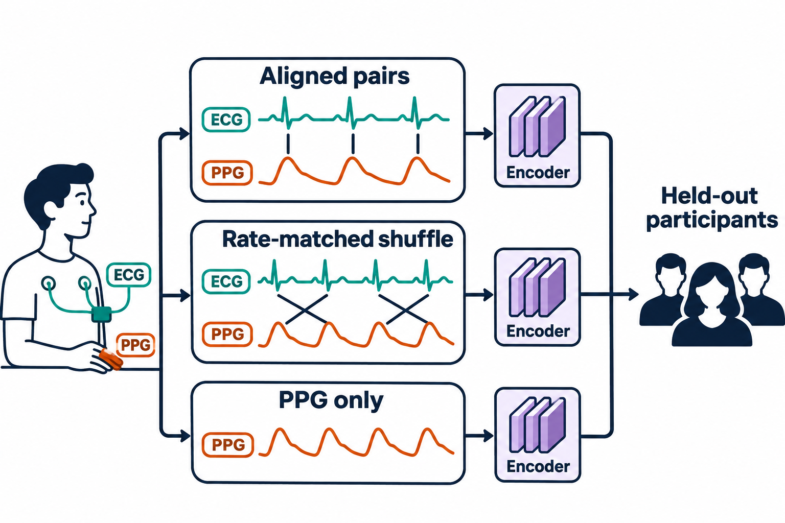
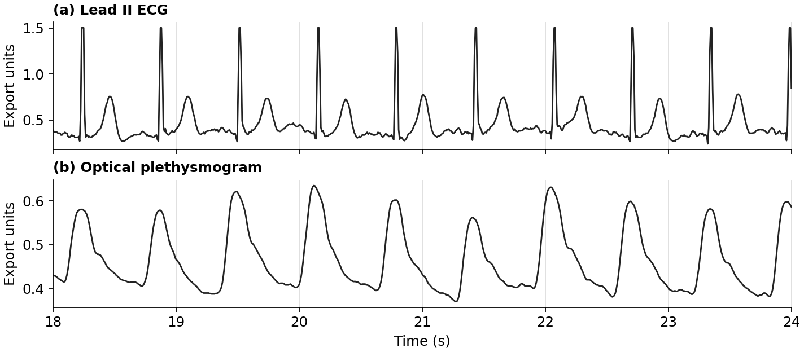
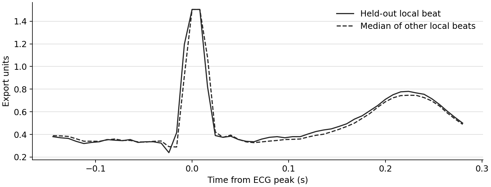

# What Can PPG Tell You About an ECG It Never Recorded?

I started with an ECG and an optical pulse recorded at the same time. The two traces had a clear shared rhythm, but that was only the first part of the comparison. I wanted to see what happened when I moved from counting beats to comparing their shape. I ran three checks on the same excerpt: detected peaks independently, built a template from nearby ECG beats, and measured how the waveform error changed when I shifted the comparison beat.

## 1. Compare the recorded signals

I took seconds 18 through 24 from BIDMC record 01, using the lead II ECG and the optical plethysmogram on the published 125 Hz sample grid. In the raw traces, the ECG complexes are sharp and brief while the optical pulses rise and fall more gradually. The three training arms in Figure 1 show the context for this experiment. The measurements below come from the recorded signals and a local ECG template.





[Get the BIDMC recording and data documentation](https://physionet.org/content/bidmc/1.0.0/).

## 2. Detect the peaks in each channel

I used a height threshold of 1.1 export units on the ECG and a prominence threshold of 0.07 on the PPG. Both detectors used a minimum separation of 50 samples. I then cut neighborhoods from 18 samples before each detected peak to 35 samples after it and aligned the snippets to the peak in their own channel.

```python
import numpy as np
from scipy.signal import find_peaks

fs = 125
record = np.genfromtxt("bidmc_01_Signals.csv", delimiter=",", names=True)
excerpt = record[18 * fs:24 * fs]
ecg = excerpt["II"]
ppg = excerpt["PLETH"]
ecg_peaks, _ = find_peaks(ecg, height=1.1, distance=50)
ppg_peaks, _ = find_peaks(ppg, prominence=0.07, distance=50)

for peaks in (ecg_peaks, ppg_peaks):
    later_peak_s = 18 + peaks[1:] / fs
    interval_s = np.diff(peaks) / fs
    print(np.column_stack((later_peak_s, interval_s)))
```


I saw variation in the shape of the individual peaks in Figure 3, even though many of the intervals in Figure 4 were similar. I plotted each interval at its later peak and kept the channels separate. That let me compare the rhythms without assuming which optical pulse matched each ECG beat.

## 3. Build the ECG-only template

I held out the last eligible ECG beat from the excerpt and took the pointwise median of the other peak-aligned ECG snippets. The overlay uses the detected ECG peak to align the comparison beat. The template comes from the same six seconds and uses no PPG input. Figure 5 shows how closely that local template can resemble an ordinary ECG beat even without any information from the optical channel.



## 4. Move the beat and measure the error

I shifted the comparison beat one sample at a time, equivalent to 8 ms per step. For every offset, I calculated the mean squared difference over the same central template samples. Keeping that comparison region fixed meant that only the offset changed. Figure 6 shows the resulting sensitivity to timing.


I came away with two checks I can use when reading a reconstruction score. With the local template, I saw how closely I could approximate an ordinary beat using nearby ECG beats alone. With the shift sweep, I saw the error change just by moving the comparison beat. Running those checks together helped me separate the resemblance of the waveform from the timing of the beat.
