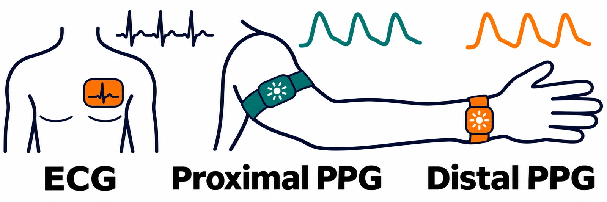
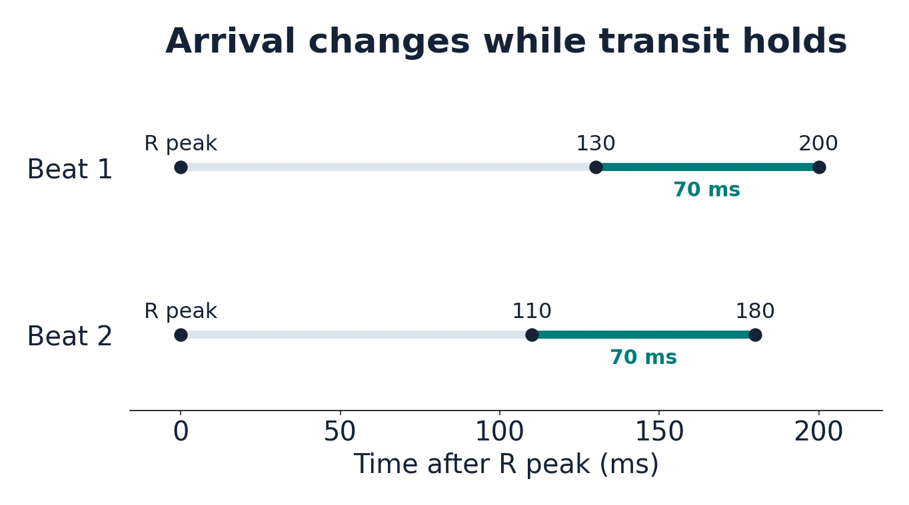
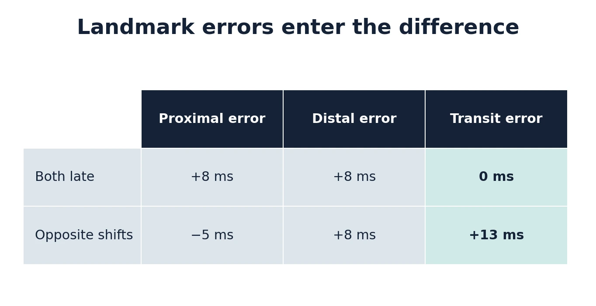

# Pulse Arrival Time vs. Pulse Transit Time in Wearables

ECG-to-PPG pulse arrival time includes a delay before ejection. Two-site pulse transit time isolates a different interval, with its own measurement errors.

A wrist prototype measures a shorter interval between the ECG R wave and the optical pulse after a participant stands up. The timing change is real if the sensors are aligned and the landmarks are stable. What changed physiologically is harder to tell. The interval starts at an electrical event and ends at a peripheral pulse, so it can shorten before the wave has moved any faster through the arm.

## Put three landmarks on the same beat

Define the ECG R peak, a proximal pulse foot, and a distal pulse foot on a common clock. The pulse foot is a point near the start of the rise, defined by a specific algorithm. Now you can compute two different quantities from the same beat:

| Measurement | Start | End |
| --- | --- | --- |
| ECG-to-distal pulse arrival time (PAT) | ECG R peak | Distal pulse foot |
| Two-site pulse transit time (PTT) estimate | Proximal pulse foot | Distal pulse foot |

The difference between those measurements is the R-to-proximal-foot delay. A peripheral proximal sensor records the pulse after ejection and after some propagation to that sensor. If you want to estimate the delay to actual aortic valve opening, you need a mechanical or flow reference for that event. State how you define the electrical start as well. An interval measured from the R peak and one measured from QRS onset use different clocks within the same beat.

Zhang and colleagues tested how pre-ejection timing affected the relationship between pulse arrival time and blood pressure. Their animal experiment used invasive pressure measurements and interventions that changed cardiovascular conditions. Gao and colleagues later compared noninvasive timing estimates against invasive measurements. These comparisons are useful because they separate variation due to the measurement method from variation in the arterial transit interval itself. They do not establish a universal conversion from a wrist timing measurement to pressure. [Zhang et al., PAT and PTT comparison](https://pubmed.ncbi.nlm.nih.gov/21960657/). [Gao et al., Comparison of noninvasive pulse transit time estimates](https://doi.org/10.14814/phy2.12768).

## Work an example before fitting a model

Take two illustrative beats on aligned sensors. In the first, the proximal foot comes 130 ms after the R peak and the distal foot comes at 200 ms. The two-site estimate is 70 ms. In the second, the two feet move 20 ms earlier, to 110 and 180 ms. PAT falls from 200 to 180 ms while the two-site estimate remains 70 ms. Those observations localize the change to the combined interval from the R peak to the proximal pulse foot. They do not pinpoint which part of that upstream interval changed.

A practical analysis retains the three timestamps so you can reconstruct both intervals. If the device exports only PAT, you lose the ability to tell whether the proximal foot, distal foot, or both moved relative to the ECG. If the proximal channel drops out, record that the transit estimate is missing. The remaining ECG and distal PPG still support a measurement of arrival time.

## Budget for errors that look like physiology

A 100 Hz optical stream has one sample every 10 ms. That is a sampling interval, not a guarantee that any particular foot is accurate to 10 ms. A threshold or interpolated tangent can produce a sub-sample timestamp, but its error depends on noise, waveform shape, and the algorithm’s assumptions. A filter can change the slope used to locate the foot. Different filters on two otherwise aligned channels can change their measured separation.

Write down the terms individually. If the distal landmark is detected 8 ms late and the proximal landmark 5 ms early, the measured PTT is 13 ms too long. A common 8 ms offset cancels from the difference if it applies equally to the two optical channels. It does not cancel from ECG-to-PPG arrival time if the ECG uses a different time base. The [wearable signal filtering article](/blog/wearable-signal-filtering) covers additional cases where a visually smoother waveform can move a timing landmark.

Validate alignment using an observable common event or a shared hardware clock. For packetized devices, retain device timestamps instead of substituting arrival times at the phone. Then vary filter settings and rerun the landmark detector on the same synchronized data. Plot the timing differences by waveform quality and activity. This makes a hardware offset easier to distinguish from a detector that follows a changing pulse shape.

## Validate pressure separately from timing

Begin with the claim you want to test. A proof of timing measures whether the device can reproduce a reference interval. A claim about blood pressure adds a calibration model and a separate reference measurement. Declare whether that claim concerns changes within one person, absolute readings across participants, or stability after the calibration date. Those questions require different test splits.

When calibration is subject-specific, keep calibration data separate from the nights, visits, or challenges used to score the model. Report error by participant and condition, and record how long each observation falls after calibration. Also report how often timing was unavailable. Dropping the noisy intervals can make the pressure estimate look more stable while removing the very conditions a wearable was supposed to cover.

A useful debug record retains the three timestamps, the detection confidence at each channel, the clock alignment, and any available reference measurements. When an estimated pressure changes, you can inspect the beat and see which timestamp moved. That is the level of detail needed to decide whether the next experiment should target the sensor, the landmark detector, or the calibration model.
