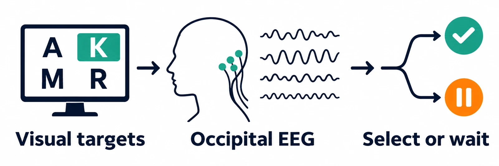
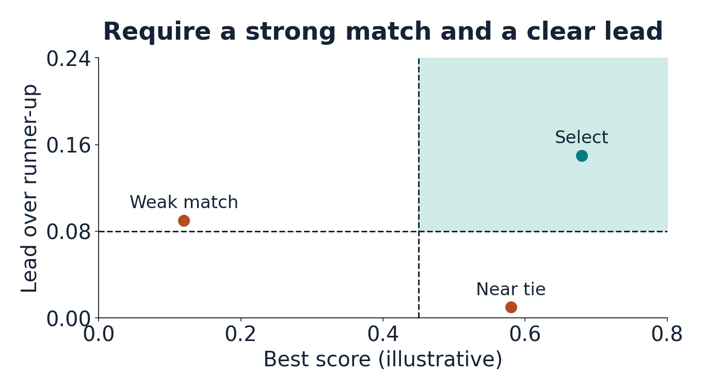
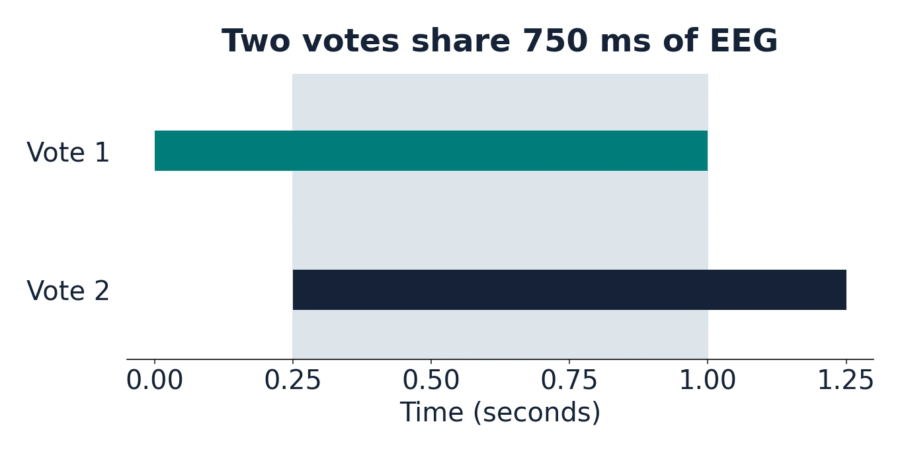

# How an SSVEP EEG Speller Knows When to Wait

An SSVEP EEG speller matches brain activity to visual targets. Idle testing, confidence thresholds, and timing determine whether it can avoid false selections.

During a cue-guided spelling trial, someone looks at a highlighted letter. The decoder has a short window and one job: find the letter. Between letters, people blink, think about what to type next, and look away. A decoder that always picks the strongest match will still choose a letter. If you’re building an EEG speller, the idle interval deserves its own benchmark.

## Match the EEG to a visual target

A steady-state visual evoked potential, or SSVEP, is a periodic brain response to a repetitive visual stimulus. With several visual targets, the system can use a different stimulus frequency or frequency-and-phase pattern for each target. The response can contain energy at the stimulus frequency and its harmonics. Electrodes over the back of the head are often useful because they record activity near visual cortex.

Canonical correlation analysis (CCA) provides a baseline. Construct sine and cosine reference signals at each candidate frequency and its chosen harmonics. For a given candidate, CCA finds linear combinations of the measured EEG channels and of the reference signals that correlate most strongly. Compare those scores across targets. Because the reference includes both sine and cosine, a phase shift at a harmonic can be represented by their combination. An ordinary CCA score with this setup should not be treated as a way to distinguish targets that differ only by phase.

The original SSVEP benchmark from Wang and colleagues used a 40-target speller with 64-channel EEG from 35 participants in a cue-guided study. Each participant completed six blocks of 40 trials. It gives you a way to compare decoders under controlled target selection. The cue-guided structure defines how you should interpret the result: the user was asked to select one known target in each trial. [Wang et al., A Benchmark Dataset for SSVEP-Based Brain-Computer Interfaces](https://pubmed.ncbi.nlm.nih.gov/27849543/).

## Measure the wait decision

Take a candidate score of 0.58 with a runner-up at 0.57. A large absolute score can coexist with weak evidence about which target won. Now take a best score of 0.12 and a runner-up at 0.03. The margin is larger, but the global match is weak. Test an absolute score threshold and a margin threshold separately, then see how they behave together. The example below uses invented scores; the cutoffs illustrate the logic and have no clinical or experimental meaning.

Collect idle examples that resemble the product’s actual idle state. One protocol can include a live display when a participant is resting without intending to select, reading without issuing a command, and looking outside the interface. Record these separately. Idle with a live display is a particularly important condition because looking at a visual target can produce a response even when the person does not intend to issue a command. A design may need an explicit activation step or a way to undo an unintended character.

Keep target trials and idle recordings together within the same study split for a participant or session. If you intend to deploy without user calibration, hold out whole participants. If you intend to calibrate per user, set aside separate sessions and report the amount of calibration needed. Fit the score threshold on development data and evaluate it once on held-out recordings.

## Test the decoder on its actual clock

A frame drawn by the application is not necessarily a frame emitted by the monitor. When timing matters, measure display onset, record the acquisition timestamp for each EEG block, and account for missing samples. A photodiode can provide an observed luminance trace for a display timing test. Log display refresh and the commanded pattern alongside the measured trace, especially if you plan to move software between displays.

Model context affects latency as well. A decoder with a one-second rolling window and a 250 ms step can update four times a second after it has enough samples. The overlapping windows share most of their data. Requiring two consistent votes adds one step after the first vote, but the two votes provide less independent evidence than disjoint windows would. If a user shifts gaze during the shared portion, both scores can reflect the same mixed observation.

Report time to first valid selection from observed stimulus onset, plus time through any confirmation or cooldown. The recent [biosignal window-length article](/blog/biosignal-window-length) discusses a related design problem: increasing the time available to a decoder changes both the evidence it can use and when the result can be delivered.

## Report what happens during a spelling session

In a forced-choice evaluation, report accuracy over target trials and show which targets the decoder confuses. In a self-paced session, add false selections per idle minute, the fraction of intended selections that time out, and the median and tail of selection latency. Report correct characters per minute after correction if the interface supports deletion or undo. A metric calculated only on accepted trials can improve as the system waits more often.

As an illustrative calculation, six false selections in 20 idle minutes give 0.3 false selections per minute. A second test with the same six errors over 60 idle minutes gives 0.1 per minute. The exposure time changes the interpretation, so publish the raw event counts alongside the rates. Also report whether a false selection locked the interface into a cooldown or could trigger another selection immediately.

For the next experiment, replay a session with target and idle intervals on a shared time axis. Mark the strongest two decoder scores and the exact time each character was emitted. That view helps distinguish a problem with the evidence window from a problem with the decision policy. The two can look identical in a final transcript.
