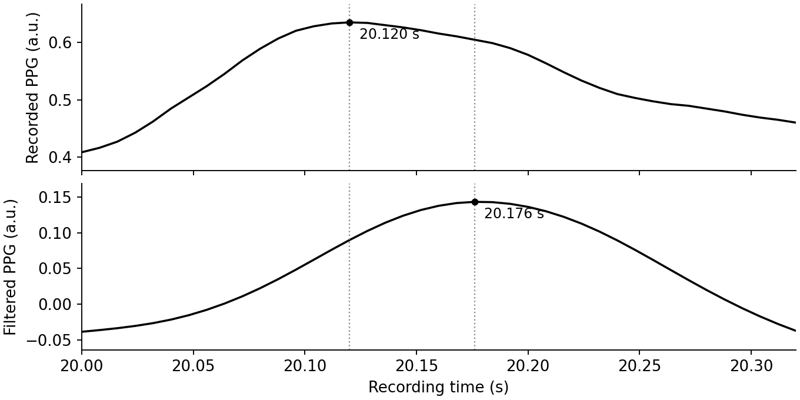
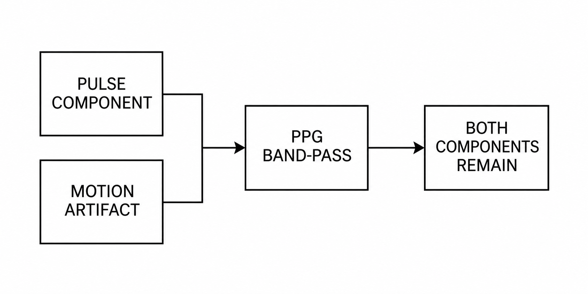
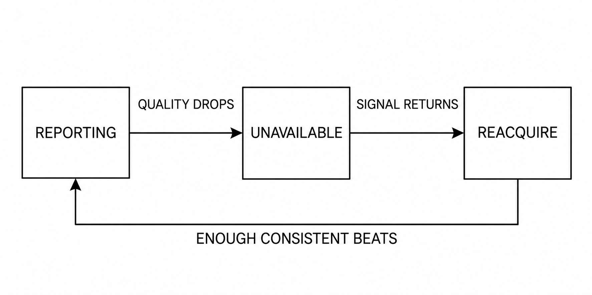

# How Do You Filter Motion Artifacts in Wearable ECG and PPG?

I ran a causal PPG filter on a public recording and checked what it changed besides the baseline. In the first pulse I inspected, the sample maximum moved by 56 ms. I also verified that feeding the signal to the filter in one-second blocks produced the same output as processing the contiguous recording in one pass.


## 1. Inspect the recorded channels

I plotted lead II ECG and optical PPG from seconds 20 through 26 of BIDMC record 01 on the same 125 Hz sample grid. Those two traces are the starting point. The rest of the measured experiment operates on the optical channel.


[Download the record 01 CSV](https://physionet.org/files/bidmc/1.0.0/bidmc_csv/bidmc_01_Signals.csv) · [BIDMC waveform dataset](https://physionet.org/content/bidmc/1.0.0/)

## 2. Filter the PPG in blocks

I used a causal 0.6–4 Hz Butterworth band-pass. The second-order prototype produces a fourth-order band-pass, implemented as two second-order sections. I initialized the filter from the first sample and carried its state from block to block.

```python
import numpy as np
from scipy.signal import butter, sosfilt, sosfilt_zi


class StreamingPPGBandpass:
    def __init__(self, sample_rate_hz):
        self.sos = butter(
            2, (0.6, 4.0), btype="bandpass", fs=sample_rate_hz, output="sos"
        )
        self.reset()

    def reset(self):
        self.state = None

    def process(self, samples):
        block = np.asarray(samples, dtype=float)
        if block.size == 0:
            return block

        if self.state is None:
            self.state = sosfilt_zi(self.sos) * block[0]

        filtered, self.state = sosfilt(self.sos, block, zi=self.state)
        return filtered
```

I filtered from the beginning of the recording so that the displayed interval excluded startup. The assertion compares the block output with the output from a fresh filter processing the entire recording in one pass.

```python
import matplotlib.pyplot as plt

record = np.genfromtxt("bidmc_01_Signals.csv", delimiter=",", names=True)
ppg = record["PLETH"]
fs = 125
time = np.arange(ppg.size) / fs

baseline = StreamingPPGBandpass(fs)
blocks = [ppg[start:start + fs] for start in range(0, ppg.size, fs)]
filtered = np.concatenate([baseline.process(block) for block in blocks])
np.testing.assert_allclose(filtered, StreamingPPGBandpass(fs).process(ppg))

peak_window = (time >= 20.0) & (time < 20.32)
print(time[peak_window][np.argmax(ppg[peak_window])])
print(time[peak_window][np.argmax(filtered[peak_window])])

visible = (time >= 20) & (time <= 26)
fig, axes = plt.subplots(2, 1, sharex=True)
axes[0].plot(time[visible], ppg[visible])
axes[0].set_ylabel("Recorded PPG")
axes[1].plot(time[visible], filtered[visible])
axes[1].set_ylabel("Filtered PPG")
axes[1].set_xlabel("Recording time (s)")
plt.show()
```

## 3. Measure what changed

The filtered trace looked more centered, but when I zoomed in on the first pulse, I found that its maximum had moved from **20.120 s to 20.176 s**. That was a **56 ms** shift on the same sample grid. I could still see a regular sequence of pulses, so I only caught the timing change by comparing the two maxima directly.




## Why the pipeline separates filtering from reporting

The filter check provides one part of the larger pipeline shown in Figure 1. Figure 5 illustrates a different problem: motion and pulse energy can share the passband and survive the same filter. Figure 6 sketches a reporting policy for an interrupted signal. Both diagrams illustrate mechanisms rather than measurements from the BIDMC run.





Comparing one-second blocks with the full trace confirmed that I was preserving the filter state correctly. Comparing the raw and filtered maxima caught a different issue: the filter itself changed the timing feature I was measuring. I needed both checks to understand what the pipeline was doing to this recording.
