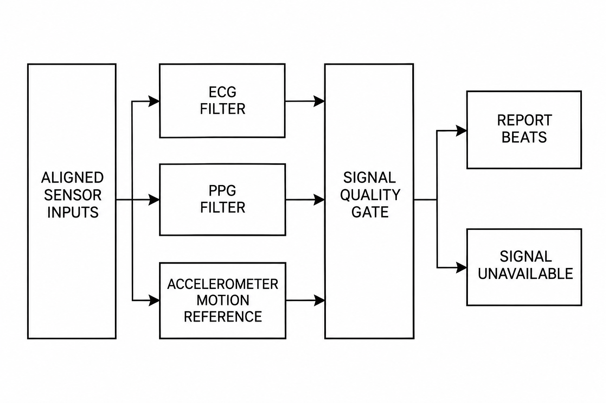
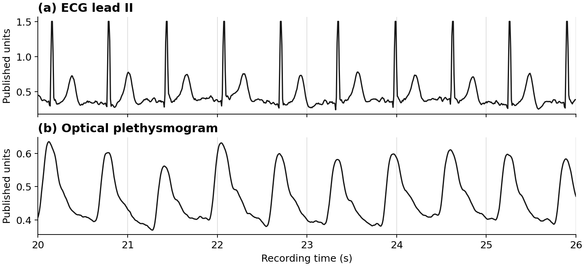
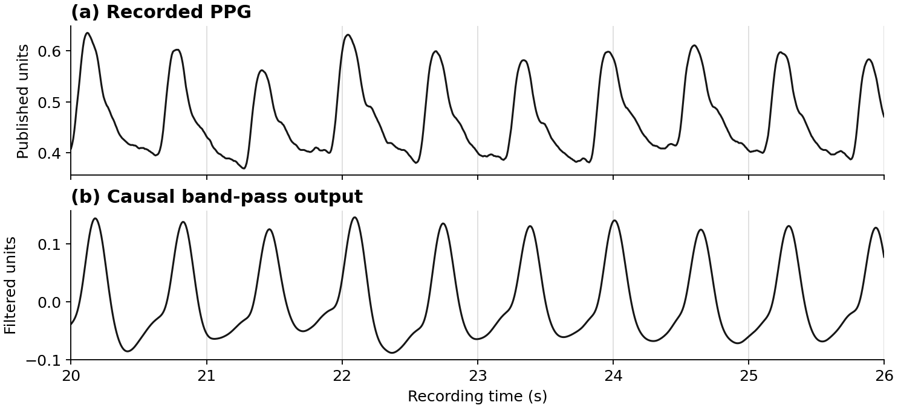

# How Do You Filter Motion Artifacts in Wearable ECG and PPG?

It's easy to make a wearable signal look clean in a notebook. Take a few seconds of ECG or PPG from someone sitting still, run a band-pass filter, and the beats mostly find themselves. Then put the same sensor on someone running. The strongest peak in the optical signal can follow their arm swing, and a loose electrode can produce a sharp transient right where your ECG detector expects a beat.

That changes the engineering question. How much of the remaining waveform can you trust, and what should the device report when two explanations fit the same data? I'd start with separate filters for ECG and PPG, then make signal quality part of the output.

## The pipeline at a glance

ECG measures the electrical activity of the heart. PPG measures changes in light absorption associated with peripheral blood volume. They capture different parts of the same beat, and they pick up different artifacts on the wrist. Giving both streams the same filter makes it harder to tell which part of the waveform you can still use.



1. **Acquisition.** Keep timestamps for ECG, PPG, and the accelerometer. Flag dropped samples, clipping, and contact loss before filtering. A saturated sample tells you the front end ran out of range. The original amplitude is already gone.
2. **ECG conditioning.** Use a filter chosen for the feature you need. A QRS detector can benefit from suppressing slow drift and some high-frequency noise. A morphology analysis has to preserve features that a beat detector can afford to discard. Electrode motion is particularly tricky because the transient can resemble an ectopic beat. [Moody et al., MIT-BIH Noise Stress Test Database](https://physionet.org/content/nstdb/1.0.0/)
3. **PPG conditioning.** Remove slow drift and attenuate frequencies outside the pulse band. Check acceleration for cadence peaks, then combine that information with waveform quality and recent beat history. Treat acceleration as evidence of motion. Changes in contact pressure can affect the optical trace even when the motion reference is weak.

## 1. Read the two signals on a shared clock

Open the paired recording first. In the upper panel, look for the sharp ECG complexes. Then trace vertically down and compare the timing with the optical pulses. Both panels use the same published sample grid, but the landmarks describe different events. Before interpreting an ECG-to-PPG delay, define how you pair beats and verify the timing through both monitor channels. The plot alone does not establish that calibration.



This is a hospital-monitor recording sampled at **125 Hz**. It gives us a pair of real signals to work through before we tackle wrist motion. The vertical values come from the published CSV in device-scaled units. For these plots, time comes from sample index divided by 125 because the CSV timestamps are rounded. [BIDMC waveform dataset](https://physionet.org/content/bidmc/1.0.0/) · [Pimentel et al., pulse oximetry study](https://doi.org/10.1109/TBME.2016.2613124) · [PhysioNet platform citation](https://doi.org/10.1038/s44360-026-00096-z)

| Measurement | What to preserve | What to compare |
| --- | --- | --- |
| ECG beat detection | Repeatable QRS landmarks | Missed beats, extra beats, and timing error |
| PPG rate over a window | The pulse fundamental or a consistent pulse sequence | Rate error and the fraction of windows reported |
| ECG-to-PPG timing | A defined landmark in each stream and a shared clock | Landmark shifts before and after filtering |
| Waveform morphology | The specific amplitude, slope, or shape under study | Feature distortion against the original or a validated reference |

I’d make one decision before writing any filter code. What will the system do with the output? If the only job is to estimate an average rate over a window, the estimator can tolerate some distortion of individual pulses. If the job is to timestamp each beat, consistency across beats matters much more. If the job is to study waveform morphology, even small changes in amplitude, slope, or relative timing can change the feature you end up measuring. Those three jobs can start with the same data and legitimately end with three different pipelines.

ECG is a good example. A detector designed around the QRS complex can emphasize the relatively steep changes that accompany ventricular depolarization. That can make the detection problem easier while attenuating slower features elsewhere in the waveform. Pan and Tompkins used band-pass filtering and operations that emphasized slope and energy as part of a real-time QRS detector. The filter was a component of a detection algorithm with a specific end point. If I needed to compare waveform shape between recordings, I would evaluate that on a separate processing path and keep the original samples available for comparison. [Pan and Tompkins, *A Real-Time QRS Detection Algorithm*](https://pubmed.ncbi.nlm.nih.gov/3997178/)

The same separation helps on the optical side. A rate tracker can use a plausible sequence of pulses or a dominant spectral component. A pulse-timing method has to define whether it uses the foot, the steepest upslope, or the peak, because those landmarks occur at different points in the pulse. A filter that leaves windowed rate estimates nearly unchanged can still move a chosen landmark. Check the effect on the actual landmark and compare it against a synchronized reference. If the downstream feature is a delay between ECG and PPG, include clock alignment and processing delay in that test.

A practical way to keep these paths straight is to record both the estimate and the evidence that supported it. For a beat detector that means retaining event timestamps and quality flags. For a rate tracker it means knowing which input window contributed to the estimate and whether the estimate is fresh. When the device starts behaving strangely on a new activity, those fields give you enough information to distinguish a late estimate from a wrong one.

## 2. Check the recording before you tune the filter

There's a debugging trap in wearable signal processing. You look at a bad trace and immediately start adjusting the cutoffs. Sometimes the useful information was already lost before the samples reached the filter. If the amplifier or converter clipped, a flat top represents a range limit. A digital filter can round its edges and make it look more natural, but several possible input waveforms could have produced the same clipped samples. I’d flag the original window at acquisition so the later stages can account for that ambiguity.

Sample gaps create a different problem. If you concatenate the two sides of a gap, the filter acts as though the last sample before the gap and the first sample afterward were adjacent in time. The detector can then assign a beat interval to a stretch of time it never observed. Keep track of sample timestamps or sequence numbers, and carry a discontinuity flag alongside the data. If you interpolate small gaps for a specific algorithm, preserve a mask so downstream evaluation can distinguish observed samples from filled samples.

Alignment matters even when every packet arrives. Two sensors can run at different nominal sample rates, and independent clocks can drift over a long recording. Matching arrays by index gives a precise-looking answer to the wrong question. I’d put both streams on a common time basis, check alignment at multiple points in a recording, and document any resampling. The PPG-DaLiA authors describe using a deliberate movement gesture visible to accelerometers on both devices to help synchronize their recordings. That’s a useful reminder that a synchronization method needs an observable event or a shared clock. [Reiss et al., *Deep PPG*](https://doi.org/10.3390/s19143079)

The acquisition flags should survive all the way to the output. A window can have a perfectly ordinary filtered shape and still contain a missing block, a clipped segment, or bad contact. Throw away that context and you’ll spend time tuning the wrong part of the system.

### ECG failure modes to test

Baseline wander is a slow movement of the apparent zero level. It can shift the reference level under successive beats and make a fixed amplitude threshold unreliable. Muscle activity adds a different kind of interference, often with energy extending into frequencies relevant to detection. Electrode motion can produce a transient sharp enough to look like a cardiac event. The PhysioNet Noise Stress Test Database separates noise recordings dominated by these three sources, giving you a way to ask which kind of disturbance is breaking a detector. [Moody et al., *MIT-BIH Noise Stress Test Database*](https://physionet.org/content/nstdb/1.0.0/)

For a rate-oriented ECG path, I’d start by checking whether a simple detector fails because its threshold is insensitive to changes in amplitude or because the artifact actually resembles a QRS complex. Those failures can produce the same extra beat in an output log. In the first case, an adaptive threshold or a better baseline estimate may help. In the second, you may need additional evidence about signal quality, such as a contact flag or agreement with another usable lead. Simply making the filter narrower can leave the artifact in place while also weakening a real complex.

A refractory interval is another useful constraint with a specific job. It can stop a detector from firing repeatedly on the same complex. It can’t tell you whether the first trigger was valid. Evaluate over the rate range and conditions the device is supposed to handle, and check the effect on closely spaced reference beats. Excluding plausible beats can look like better noise suppression in an aggregate chart if the evaluation omits the cases the constraint handles poorly.

I’d also keep separate error counts for **missed beats**, **extra beats**, and **timing errors**. When a movement transient falls near a real beat, the detector might report the wrong point while still returning the right number of beats. In that case, rate can look adequate and beat timing can be seriously wrong. Match detections to annotations one to one with a declared tolerance so a single annotation can’t receive credit for two detections.

## 3. Build and run a streaming PPG baseline

The notebook version usually filters a whole recording at once. On the device, samples arrive in blocks. If you reset the filter at every block boundary, each block starts with its own transient. A beat detector can pick up those edges as if they came from the sensor.

Here's a small streaming PPG baseline. The 0.6–4 Hz cutoffs are a starting point for a pulse-rate baseline. The code uses a causal filter suitable for block-by-block processing. The second-order Butterworth prototype produces a fourth-order band-pass realized as two second-order sections. Check the response at the intended sample rate and for the intended pulse range before using these settings. [SciPy, second-order-section filtering](https://docs.scipy.org/doc/scipy/reference/generated/scipy.signal.sosfilt.html)

```python
import numpy as np
from scipy.signal import butter, sosfilt, sosfilt_zi


class StreamingPPGBandpass:
    def __init__(self, sample_rate_hz):
        self.sos = butter(
            2, (0.6, 4.0), btype="bandpass", fs=sample_rate_hz, output="sos"
        )
        self.reset()

    def reset(self):
        self.state = None

    def process(self, samples):
        block = np.asarray(samples, dtype=float)
        if block.size == 0:
            return block

        if self.state is None:
            self.state = sosfilt_zi(self.sos) * block[0]

        filtered, self.state = sosfilt(self.sos, block, zi=self.state)
        return filtered
```

Process contiguous, valid samples through the same instance. After a gap or loss of contact, reset and mark the settling interval as low quality. If you're measuring ECG-to-PPG timing, test the whole chain against a synchronized reference. Causal filtering can shift fiducials, and ECG and PPG peaks already have a physiological delay between them.

### Run the baseline on the recorded PPG

Save the [BIDMC record 01 CSV](https://physionet.org/files/bidmc/1.0.0/bidmc_csv/bidmc_01_Signals.csv) as `bidmc_01_Signals.csv`. Add the following below the class. Filtering begins at the start of the recording so the displayed window excludes filter startup.

```python
import matplotlib.pyplot as plt

record = np.genfromtxt("bidmc_01_Signals.csv", delimiter=",", names=True)
ppg = record["PLETH"]
fs = 125
time = np.arange(ppg.size) / fs

baseline = StreamingPPGBandpass(fs)
blocks = [ppg[start:start + fs] for start in range(0, ppg.size, fs)]
filtered = np.concatenate([baseline.process(block) for block in blocks])
np.testing.assert_allclose(filtered, StreamingPPGBandpass(fs).process(ppg))

peak_window = (time >= 20.0) & (time < 20.32)
print(time[peak_window][np.argmax(ppg[peak_window])])
print(time[peak_window][np.argmax(filtered[peak_window])])

visible = (time >= 20) & (time <= 26)
fig, axes = plt.subplots(2, 1, sharex=True)
axes[0].plot(time[visible], ppg[visible])
axes[0].set_ylabel("Recorded PPG")
axes[1].plot(time[visible], filtered[visible])
axes[1].set_ylabel("Filtered PPG")
axes[1].set_xlabel("Recording time (s)")
plt.show()
```



Look at the low points between pulses. The filtered trace is centered closer to zero and has a different contour. In the first pulse window, the sample maximum moves from **20.120 s to 20.176 s**, a shift of **56 ms** for this pulse and filter. This is an observed change in the PPG waveform peak, and its size can vary with waveform shape and filter settings. Try moving the high-pass cutoff and look at the effect on those troughs and on the timing of the upstrokes. A pulse rate can look steady while the waveform features you might want for a timing study shift. The block-equivalence assertion tests something narrower: the streaming implementation produces the same output regardless of how this contiguous recording is divided into blocks.


## 4. Find out when the tracker is following motion

If a runner’s wrist motion repeats at a frequency inside the pulse passband, the band-pass filter will pass some of that motion along with the pulse. What looks like a clean, periodic output can still be dominated by the wrong source. The same problem can arise when a harmonic of the motion lands near the pulse frequency.


This is where a simple peak picker falls apart. An adaptive filter can reduce motion when the accelerometer captures the interference, but aggressive subtraction can also remove pulse energy when cadence and heart rate overlap. I'd downweight ambiguous peaks, check for a compatible beat sequence in the ECG when it's usable, and return **signal unavailable** when the remaining evidence is weak. TROIKA is a useful example of taking the tracking problem seriously. It combines signal decomposition, spectral estimation, and peak tracking with verification. [Zhang et al., TROIKA](https://arxiv.org/abs/1409.5181)

### Use acceleration to test a candidate

The accelerometer tells you something about movement of the device. It doesn’t directly measure the optical disturbance or how tightly the sensor is touching skin. This matters when a strap shifts, when pressure changes without much acceleration, or when the relationship between arm movement and sensor contact changes within a window. I’d treat a shared frequency between acceleration and PPG as a reason to inspect a candidate more carefully. A shared peak alone can’t identify which portion of the optical energy came from the pulse.

An adaptive noise canceller is worth testing when the motion reference predicts the interference reliably. It estimates the part of the optical signal that can be predicted from the motion channels, then subtracts that estimate. The method depends on the relationship between the reference and the artifact. When genuine pulse energy also correlates with the reference over the adaptation window, subtraction can suppress useful content. When that relationship changes abruptly, a filter trained on the last few seconds can lag behind the current motion. This is where comparing the output before and after subtraction helps. Does the candidate peak become clearer, disappear, or jump to a harmonic? [Widrow et al., *Adaptive Noise Cancelling*](https://ieeexplore.ieee.org/document/1451965/)

A spectral tracker has another tradeoff. Longer windows give you finer nominal frequency spacing and more cycles to judge a peak. Shorter windows follow changes sooner. If cadence or pulse rate changes substantially inside a long window, the assumption of a stable periodic source becomes weaker. Zero padding makes the spectrum easier to inspect on a denser frequency grid, but the information available to distinguish two close components still depends on the observed samples and their duration.

I’d score candidates using multiple cues. Is the peak persistent across neighboring windows? Is a plausible fundamental present when the largest peak could be a harmonic? Does the time-domain waveform contain a repeatable pulse pattern? Is the ECG usable and broadly consistent with the optical rate? Any one of these can fail. Combining them gives the tracker enough context to avoid treating the largest peak as a measurement by default.

### Let the tracker lose and regain lock

Quality gating is where the pipeline starts to behave like a product. Imagine the device had a solid estimate, the wearer adjusted the strap, and a few seconds later usable pulses came back. There are three parts to that sequence. The system needs to detect the loss of evidence, represent the uncertain interval, and reacquire the pulse with fresh evidence. If it keeps publishing its last good value as though it were current, the interface can look stable through the entire failure.


I’d make the raw-quality checks explicit for clipping, gaps, and contact loss when the hardware exposes it. Then I’d apply a separate confidence check to an otherwise valid window. The second check can use candidate separation, waveform consistency, motion context, and an independent sensor when available. A contact failure and a difficult but valid measurement window are different events. Logging them separately helps explain whether better hardware placement, filtering, or tracking would solve the problem.

A bit of hysteresis can prevent the device from flipping between available and unavailable every time a confidence score crosses one threshold. Using different entry and exit criteria for the locked state is one way to do that. Test the extra delay it introduces. Requiring more evidence to reacquire can suppress a false lock, but it can also increase the time before the device reports again. A smoothing rule should be tested during genuine rate changes as well as artifacts so it doesn’t keep a stale estimate merely because it was plausible a few seconds ago.

When both sensors are present, ECG can help adjudicate a PPG candidate if ECG quality is good and the time bases agree. ECG and PPG agreement is checks-and-balances evidence. It still matters which sensor produced the reported value. If a PPG evaluation uses ECG as both a runtime input and the scoring reference, disclose that. A wearable with optical sensing alone cannot be expected to reproduce that operating condition.

## 5. Evaluate failure, coverage, and recovery

I'd stress-test ECG first with baseline wander, muscle artifact, and electrode motion as separate conditions. For PPG, I'd compare a band-pass baseline, a motion-aware tracker, and the same tracker with a quality gate. I'd break out rest, steady movement, and changes in cadence, then keep participants separate between tuning and evaluation. [MIT-BIH Noise Stress Test Database](https://physionet.org/content/nstdb/1.0.0/) · [TROIKA exercise recordings and protocol](https://arxiv.org/abs/1409.5181)

- **Beat detection.** Report missed and extra beats against a reference, along with the timing error on matched beats.
- **Heart-rate tracking.** Report absolute error alongside coverage, the fraction of windows that receive an estimate. A tracker can look better on average by withholding its hardest windows.
- **Streaming behavior.** Measure the delay before an estimate is available and how long the system takes to recover after contact returns.

### What the results can tell you

The most interesting result here is a change in what counts as a successful filter. If I look only at whether the trace came out smoother, I can miss the hardest problem. The part I care about is whether a pulse estimate stays attached to cardiac activity when motion starts, whether it fails visibly when evidence runs out, and how quickly it finds the pulse again. Figure 5 explains why a band-pass alone leaves that question open. It is an architecture illustration of an overlap case.

There are measured results in the literature that help put the problem in perspective. The TROIKA authors reported a mean absolute heart-rate error of **2.34 bpm** in their experiment on recordings from **12 subjects** during intense treadmill exercise. That number belongs to their complete decomposition, spectral reconstruction, and verified tracking pipeline under their experimental protocol. It gives an example of what a motion-aware tracker can achieve in a defined setup. It says little by itself about performance after a loose strap, on a different optical module, or across a different activity mix. [Zhang, Pi, and Liu, *TROIKA*](https://arxiv.org/abs/1409.5181)

PPG-DaLiA gets at a different question. Reiss and colleagues released synchronized recordings from **15 participants**, with wrist PPG and acceleration, chest ECG, and activities that extend beyond controlled exercise. A detector can handle steady repetitions well and still struggle with starting, stopping, changing arm position, or doing an activity with weak periodic motion. The recordings make it possible to break down performance by activity and inspect when the estimator follows movement instead of the ECG-derived rate. [Reiss et al., *Deep PPG*](https://doi.org/10.3390/s19143079)

Use the same reference and matched windows for each method. This is the comparison I’d run.

| Run | Runtime inputs | What the comparison isolates |
| --- | --- | --- |
| Band-pass baseline | PPG | How often a simple tracker follows the wrong periodic source |
| Motion-aware tracker | PPG and wrist acceleration | What motion evidence adds to candidate selection |
| Motion-aware tracker with gating | The same PPG and acceleration | How withholding uncertain windows changes error, coverage, and recovery |

I'd look for three patterns in a comparison of the baseline, the motion-aware tracker, and the tracker with gating.

1. **Cadence lock.** Inspect windows where the optical estimate is closer to a motion frequency than to the reference rate. The important comparison is how often the baseline gets stuck there and whether the motion-aware version recovers. Also inspect cases where cadence and reference rate genuinely agree. Rejecting everything near cadence can take out correct estimates.
2. **Accuracy at a given coverage.** Compare absolute error with the fraction of reference-eligible windows for which the tracker actually reports. Sweep the confidence threshold on tuning data, then report results at a selected operating point on held-out participants. Show the unavailable fraction by activity. Otherwise an aggregate error can improve simply because the system withheld the hardest windows.
3. **Recovery after a bad interval.** Measure the elapsed time from a defined return to usable signal to the first valid estimate. Define what counts as valid before comparing methods, and account for the analysis window and output schedule. The filter can be fast while the system takes several seconds to gather enough evidence.

Keep windowing and references consistent across methods. Two algorithms evaluated with different trailing window lengths may seem to disagree during a transition because they are effectively describing different parts of it. If you optimize quality thresholds per participant using their test session, the resulting estimate answers a personalized tuning question. If the goal is performance on an unseen wearer, split by participant before choosing any thresholds or learning parameters. Overlapping windows from one recording share samples and can leak information when split randomly.

I’d always open the error distribution after reading the mean. A tracker can have modest average error and still produce a few long, convincing runs at the wrong rate. For a device that reports live estimates, the duration of those runs is part of the behavior. Report representative failure categories, and use reference data to tell genuine changes in pulse from failures of the tracker.

The test I'd care about most is what happens in the few seconds after the strap shifts. Can the device recognize that it lost the pulse, wait for enough evidence, and lock back onto a real beat? A clean plot from a quiet recording barely exercises that part of the system.
